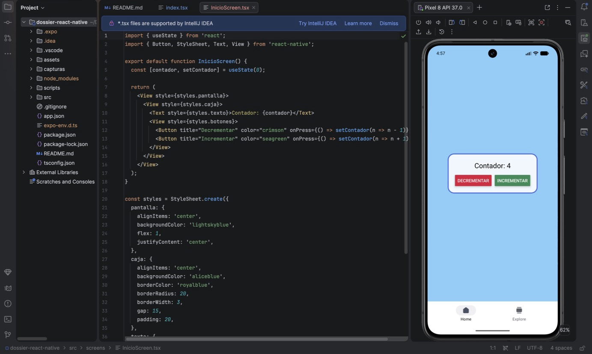

# Dossier de React Native con Expo

Programación Multimedia y Dispositivos Móviles (PGL) · 2.º DAM

Diego Alejandro Gil González

Aquí voy haciendo todas las prácticas del dossier de React Native con Expo y Android Studio. Todas van en este mismo proyecto y no borro ninguna, así se puede ver cómo va avanzando.

## Cómo arrancarlo

```bash
npm install
npx expo start
```

Con el emulador de Android Studio abierto, pulso la tecla `a` y se abre la app en Expo Go.

## Cómo está organizado el proyecto

Desde la práctica 4 la app abre con un índice que tiene un enlace a cada práctica, así no se pierde ninguna:

- `src/app/`: las rutas de Expo Router. Cada práctica tiene su archivo (`practica01.tsx`, `practica02.tsx`...) que solo exporta su pantalla, por ejemplo `export { default } from '../screens/HolaMundoScreen';`. El `index.tsx` es el índice con los `Link`.
- `src/app/_layout.tsx`: cambié las pestañas que traía la plantilla por un `Stack`, con el título de cada práctica arriba y la flecha para volver al índice. También quité `explore.tsx`, que era de la plantilla.
- `src/screens/`: el código de cada pantalla.
- `src/components/`: los componentes que reutilizo.
- `capturas/`: las capturas de este README.

## Prácticas

| Práctica | Estado |
|---|---|
| [1. Hola mundo](#práctica-1-hola-mundo) | Terminada |
| [2. Contador con dos botones](#práctica-2-contador-con-dos-botones) | Terminada |
| [3. InicioScreen y estilos separados](#práctica-3-inicioscreen-y-estilos-separados) | Terminada |
| [4. Tres cajas](#práctica-4-tres-cajas) | Terminada |

---

## Práctica 1. Hola mundo

### Qué hay que hacer
En `src/app/index.tsx` hay que hacer una pantalla que diga «¡Hola mundo! Soy Diego» con un `View` y un `Text`, fondo rosa y el texto centrado (`flex: 1`, `justifyContent: 'center'` y `alignItems: 'center'`).

### Cómo lo he hecho
1. Creé el proyecto con la plantilla por defecto de Expo:
   ```bash
   npx create-expo-app@latest dossier-react-native --template default
   ```
2. En Android Studio hice el emulador desde el Device Manager (un Pixel 8).
3. Añadí al final del `~/.bashrc` la ruta del SDK de Android para que la terminal encuentre `adb`:
   ```bash
   export ANDROID_HOME="$HOME/Android/Sdk"
   export PATH="$PATH:$ANDROID_HOME/emulator"
   export PATH="$PATH:$ANDROID_HOME/platform-tools"
   ```
   Con `source ~/.bashrc` y `adb devices` comprobé que salía el emulador como `device`.
4. Arranqué el proyecto con `npx expo start` y pulsé `a`. Se instala Expo Go en el emulador y se abre la app.
5. Cambié todo el código de `src/app/index.tsx` por la pantalla del Hola mundo:

```tsx
import { StyleSheet, Text, View } from 'react-native';

export default function Index() {
  return (
    <View style={styles.pantalla}>
      <Text>¡Hola mundo! Soy Diego</Text>
    </View>
  );
}

const styles = StyleSheet.create({
  pantalla: {
    alignItems: 'center',
    backgroundColor: 'lightpink',
    flex: 1,
    justifyContent: 'center',
  },
});
```

Al guardar, la app se recarga sola en el emulador.

### Captura


### Problemas que tuve
- En clase no me dio tiempo a que funcionara el emulador. Luego lo terminé siguiendo los pasos de la profe: configurar Android Studio, crear el Pixel y poner lo del `.bashrc`.

### Estado
Terminada.

---

## Práctica 2. Contador con dos botones

### Qué hay que hacer
Partiendo del ejemplo del contador, cambiar el color del borde y del fondo, redondear las esquinas con `borderRadius` y añadir otro botón que reste. El valor se enseña en un `Text`.

### Cómo lo he hecho
1. En `src/app/index.tsx` creé el estado `contador` con `useState(0)`.
2. Puse dos `Button`, cada uno con su `onPress`: el de «Incrementar» hace `setContador(n => n + 1)` y el de «Decrementar» hace `setContador(n => n - 1)`.
3. Puse el fondo de la pantalla en azul (`lightskyblue`) y metí el texto y los botones dentro de una caja (`View`) con fondo azul clarito, borde azul y `borderRadius: 20`, y puse los botones en fila con `flexDirection: 'row'`.
4. Los estilos van todos en `StyleSheet.create()`. El color de los botones lo cambio con la prop `color`, porque el `Button` nativo no deja ponerle estilos como a un `View`.

```tsx
import { useState } from 'react';
import { Button, StyleSheet, Text, View } from 'react-native';

export default function Index() {
  const [contador, setContador] = useState(0);

  return (
    <View style={styles.pantalla}>
      <View style={styles.caja}>
        <Text style={styles.texto}>Contador: {contador}</Text>
        <View style={styles.botones}>
          <Button title="Decrementar" color="crimson" onPress={() => setContador(n => n - 1)} />
          <Button title="Incrementar" color="seagreen" onPress={() => setContador(n => n + 1)} />
        </View>
      </View>
    </View>
  );
}
```

El código del Hola mundo está en el primer commit. En la práctica 3 lo guardo como `src/screens/HolaMundoScreen.tsx` para no perderlo.

### Captura


### Problemas que tuve
- Ninguno con el código. Lo único fue preparar el emulador en el portátil: le faltaba la imagen de Android y la tuve que volver a descargar.

### Estado
Terminada.

---

## Práctica 3. InicioScreen y estilos separados

### Qué hay que hacer
Pasar el contador de la práctica 2 a su propia pantalla, `src/screens/InicioScreen.tsx`, y que `src/app/index.tsx` solo la importe y la muestre. Los estilos con `StyleSheet.create()`.

### Cómo lo he hecho
1. Creé la carpeta `src/screens/`.
2. Moví el código del contador a `src/screens/InicioScreen.tsx` y cambié el nombre de la función a `InicioScreen`.
3. Recuperé el Hola mundo de la práctica 1 y lo guardé en `src/screens/HolaMundoScreen.tsx`, para no perderlo.
4. Dejé `src/app/index.tsx` así:

```tsx
import InicioScreen from '../screens/InicioScreen';

export default function Index() {
  return <InicioScreen />;
}
```

Lo bueno es que `src/app/` es lo que Expo Router usa como rutas y en `src/screens/` está el código de verdad de cada pantalla.

### Captura


### Problemas que tuve
- Ninguno. Comprobé que no había errores al importar y que el contador seguía sumando y restando igual.

### Estado
Terminada.

---

## Práctica 4. Tres cajas

### Qué hay que hacer
Una pantalla `PrincipalScreen` con el texto «Contenedor Principal» y un escenario con `flex: 1` donde van tres componentes `Caja` de 100 × 100, cada una con un color que le paso por propiedades.

### Cómo lo he hecho
1. Hice el componente `src/components/Caja.tsx` con dos props: `nombre` y `bg`, que es el color y por defecto es verde. Con `style={[styles.caja, { backgroundColor: bg }]}` junto el estilo base con el color que le llega.
2. En `src/screens/PrincipalScreen.tsx` puse el título en amarillo y el escenario gris claro con `flex: 1`. Dentro van las tres cajas:

```tsx
<View style={styles.escenario}>
  <Caja nombre="1" bg="rosybrown" />
  <Caja nombre="2" bg="cornflowerblue" />
  <Caja nombre="3" bg="green" />
</View>
```

3. Las cajas salen una debajo de otra porque en React Native la columna es la dirección que viene por defecto.
4. Aquí también monté el índice de prácticas (lo explico arriba, en «Cómo está organizado el proyecto»).

### Captura


### Problemas que tuve
- Al cambiar las pestañas por el `Stack`, Expo Go seguía enseñando la versión vieja con las pestañas. Se arregló recargando la app.

### Estado
Terminada.
