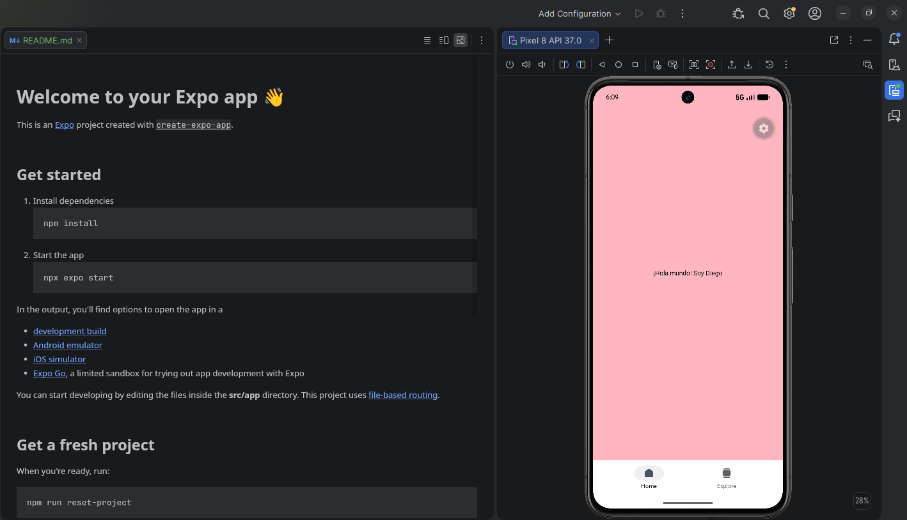

# Dossier de React Native con Expo

Programación Multimedia y Dispositivos Móviles (PGL) · 2.º DAM

Diego Alejandro Gil González

Aquí voy haciendo todas las prácticas del dossier de React Native con Expo y Android Studio. Todas van en este mismo proyecto y no borro ninguna, así se puede ver cómo va avanzando.

## Cómo arrancarlo

```bash
npm install
npx expo start
```

Con el emulador de Android Studio abierto, pulso la tecla `a` y se abre la app en Expo Go.

## Prácticas

| Práctica | Estado |
|---|---|
| [1. Hola mundo](#práctica-1-hola-mundo) | Terminada |

---

## Práctica 1. Hola mundo

### Qué hay que hacer
En `src/app/index.tsx` hay que hacer una pantalla que diga «¡Hola mundo! Soy Diego» con un `View` y un `Text`, fondo rosa y el texto centrado (`flex: 1`, `justifyContent: 'center'` y `alignItems: 'center'`).

### Cómo lo he hecho
1. Creé el proyecto con la plantilla por defecto de Expo:
   ```bash
   npx create-expo-app@latest dossier-react-native --template default
   ```
2. En Android Studio hice el emulador desde el Device Manager (un Pixel 8).
3. Añadí al final del `~/.bashrc` la ruta del SDK de Android para que la terminal encuentre `adb`:
   ```bash
   export ANDROID_HOME="$HOME/Android/Sdk"
   export PATH="$PATH:$ANDROID_HOME/emulator"
   export PATH="$PATH:$ANDROID_HOME/platform-tools"
   ```
   Con `source ~/.bashrc` y `adb devices` comprobé que salía el emulador como `device`.
4. Arranqué el proyecto con `npx expo start` y pulsé `a`. Se instala Expo Go en el emulador y se abre la app.
5. Cambié todo el código de `src/app/index.tsx` por la pantalla del Hola mundo:

```tsx
import { StyleSheet, Text, View } from 'react-native';

export default function Index() {
  return (
    <View style={styles.pantalla}>
      <Text>¡Hola mundo! Soy Diego</Text>
    </View>
  );
}

const styles = StyleSheet.create({
  pantalla: {
    alignItems: 'center',
    backgroundColor: 'lightpink',
    flex: 1,
    justifyContent: 'center',
  },
});
```

Al guardar, la app se recarga sola en el emulador.

### Captura


### Problemas que tuve
- En clase no me dio tiempo a que funcionara el emulador. Luego lo terminé siguiendo los pasos de la profe: configurar Android Studio, crear el Pixel y poner lo del `.bashrc`.

### Estado
Terminada.
