# Dossier de React Native con Expo

Programación Multimedia y Dispositivos Móviles (PGL) · 2.º DAM

Diego Alejandro Gil González

Aquí voy haciendo todas las prácticas del dossier de React Native con Expo y Android Studio. Todas van en este mismo proyecto y no borro ninguna, así se puede ver cómo va avanzando.

## Cómo arrancarlo

```bash
npm install
npx expo start
```

Con el emulador de Android Studio abierto, pulso la tecla `a` y se abre la app en Expo Go.

## Cómo está organizado el proyecto

Desde la práctica 4 la app abre con un índice que tiene un enlace a cada práctica, así no se pierde ninguna:

- `src/app/`: las rutas de Expo Router. Cada práctica tiene su archivo (`practica01.tsx`, `practica02.tsx`...) que solo exporta su pantalla, por ejemplo `export { default } from '../screens/HolaMundoScreen';`. La 2 y la 3 van juntas en `practica02.tsx`, porque la 3 es el mismo contador pasado a `InicioScreen`, y la 10 y la 11 en `practica10.tsx`, porque la 11 es la misma calculadora con un hook. El `index.tsx` es el índice con los `Link`.
- `src/app/_layout.tsx`: cambié las pestañas que traía la plantilla por un `Stack`, con el título de cada práctica arriba y la flecha para volver al índice. También quité `explore.tsx`, que era de la plantilla.
- `src/app/stack/`: las prácticas con varias pantallas, cada una en su carpeta (`p20`, `p21`...) con su `_layout.tsx`.
- `src/screens/`: el código de cada pantalla.
- `src/components/`: los componentes que reutilizo.
- `src/hooks/`: mis hooks, como `useCalculadora.ts`. Los demás archivos de esa carpeta venían con la plantilla.
- `src/app/drawer/`: las prácticas con Drawer (`p24`, `p25` y `p26`).
- `src/app/tabs/`: las prácticas con pestañas (`p27`).
- `src/api/`: las llamadas a la PokeAPI de la práctica 28.
- `src/context/`: el contexto de la práctica 23.
- `capturas/`: las capturas de este README.

## Prácticas

| Práctica | Estado |
|---|---|
| [1. Hola mundo](#práctica-1-hola-mundo) | Terminada |
| [2. Contador con dos botones](#práctica-2-contador-con-dos-botones) | Terminada |
| [3. InicioScreen y estilos separados](#práctica-3-inicioscreen-y-estilos-separados) | Terminada |
| [4. Tres cajas](#práctica-4-tres-cajas) | Terminada |
| [5. Modificar flex dinámicamente](#práctica-5-modificar-flex-dinámicamente) | Terminada |
| [6. Sustituir los botones](#práctica-6-sustituir-los-botones) | Terminada |
| [7. Nombre y estilos personalizados](#práctica-7-nombre-y-estilos-personalizados) | Terminada |
| [8. Círculos dinámicos](#práctica-8-círculos-dinámicos) | Terminada |
| [9. Distribución, alineación e imágenes](#práctica-9-distribución-alineación-e-imágenes) | Terminada |
| [9.1. Imagen aleatoria](#práctica-91-imagen-aleatoria) | Terminada |
| [10. Calculadora](#práctica-10-calculadora) | Terminada |
| [11. Hook personalizado para la calculadora](#práctica-11-hook-personalizado-para-la-calculadora) | Terminada |
| [12. Color aleatorio con confirmación](#práctica-12-color-aleatorio-con-confirmación) | Terminada |
| [13. Introducir el color](#práctica-13-introducir-el-color) | Terminada |
| [14. Borde activado por Switch](#práctica-14-borde-activado-por-switch) | Terminada |
| [15. Completar el formulario](#práctica-15-completar-el-formulario) | Terminada |
| [16. Lista de productos](#práctica-16-lista-de-productos) | Terminada |
| [17. Tarjetas para calcular el IMC](#práctica-17-tarjetas-para-calcular-el-imc) | Terminada |
| [18. Diario de emociones](#práctica-18-diario-de-emociones) | Terminada |
| [19. Insertar emoticonos en el texto](#práctica-19-insertar-emoticonos-en-el-texto) | Terminada |
| [20. Primer Stack](#práctica-20-primer-stack) | Terminada |
| [21. Stack con tres pantallas](#práctica-21-stack-con-tres-pantallas) | Terminada |
| [22. Personalizar la cabecera](#práctica-22-personalizar-la-cabecera) | Terminada |
| [23. Lista de tareas](#práctica-23-lista-de-tareas) | Terminada |
| [24. Drawer con tareas y About](#práctica-24-drawer-con-tareas-y-about) | Terminada |
| [25. Drawer personalizado y girado](#práctica-25-drawer-personalizado-y-girado) | Terminada |
| [26. Aplicación de mascotas](#práctica-26-aplicación-de-mascotas) | Terminada |
| [27. Tabs combinadas con Stack](#práctica-27-tabs-combinadas-con-stack) | Terminada |
| [28. Aplicación Pokémon](#práctica-28-aplicación-pokémon) | Terminada |
| [29. Localización del dispositivo](#práctica-29-localización-del-dispositivo) | Terminada |
| De la 30 a la 40 | Pendientes |

---

## Práctica 1. Hola mundo

### Qué hay que hacer
En `src/app/index.tsx` hay que hacer una pantalla que diga «¡Hola mundo! Soy Diego» con un `View` y un `Text`, fondo rosa y el texto centrado (`flex: 1`, `justifyContent: 'center'` y `alignItems: 'center'`).

### Cómo lo he hecho
1. Creé el proyecto con la plantilla por defecto de Expo:
   ```bash
   npx create-expo-app@latest dossier-react-native --template default
   ```
2. En Android Studio hice el emulador desde el Device Manager (un Pixel 8).
3. Añadí al final del `~/.bashrc` la ruta del SDK de Android para que la terminal encuentre `adb`:
   ```bash
   export ANDROID_HOME="$HOME/Android/Sdk"
   export PATH="$PATH:$ANDROID_HOME/emulator"
   export PATH="$PATH:$ANDROID_HOME/platform-tools"
   ```
   Con `source ~/.bashrc` y `adb devices` comprobé que salía el emulador como `device`.
4. Arranqué el proyecto con `npx expo start` y pulsé `a`. Se instala Expo Go en el emulador y se abre la app.
5. Cambié todo el código de `src/app/index.tsx` por la pantalla del Hola mundo:

```tsx
import { StyleSheet, Text, View } from 'react-native';

export default function Index() {
  return (
    <View style={styles.pantalla}>
      <Text>¡Hola mundo! Soy Diego</Text>
    </View>
  );
}

const styles = StyleSheet.create({
  pantalla: {
    alignItems: 'center',
    backgroundColor: 'lightpink',
    flex: 1,
    justifyContent: 'center',
  },
});
```

Al guardar, la app se recarga sola en el emulador.

### Captura


### Problemas que tuve
- En clase no me dio tiempo a que funcionara el emulador. Luego lo terminé siguiendo los pasos de la profe: configurar Android Studio, crear el Pixel y poner lo del `.bashrc`.

### Estado
Terminada.

---

## Práctica 2. Contador con dos botones

### Qué hay que hacer
Partiendo del ejemplo del contador, cambiar el color del borde y del fondo, redondear las esquinas con `borderRadius` y añadir otro botón que reste. El valor se enseña en un `Text`.

### Cómo lo he hecho
1. En `src/app/index.tsx` creé el estado `contador` con `useState(0)`.
2. Puse dos `Button`, cada uno con su `onPress`: el de «Incrementar» hace `setContador(n => n + 1)` y el de «Decrementar» hace `setContador(n => n - 1)`.
3. Puse el fondo de la pantalla en azul (`lightskyblue`) y metí el texto y los botones dentro de una caja (`View`) con fondo azul clarito, borde azul y `borderRadius: 20`, y puse los botones en fila con `flexDirection: 'row'`.
4. Los estilos van todos en `StyleSheet.create()`. El color de los botones lo cambio con la prop `color`, porque el `Button` nativo no deja ponerle estilos como a un `View`.

```tsx
import { useState } from 'react';
import { Button, StyleSheet, Text, View } from 'react-native';

export default function Index() {
  const [contador, setContador] = useState(0);

  return (
    <View style={styles.pantalla}>
      <View style={styles.caja}>
        <Text style={styles.texto}>Contador: {contador}</Text>
        <View style={styles.botones}>
          <Button title="Decrementar" color="crimson" onPress={() => setContador(n => n - 1)} />
          <Button title="Incrementar" color="seagreen" onPress={() => setContador(n => n + 1)} />
        </View>
      </View>
    </View>
  );
}
```

El código del Hola mundo está en el primer commit. En la práctica 3 lo guardo como `src/screens/HolaMundoScreen.tsx` para no perderlo.

### Captura
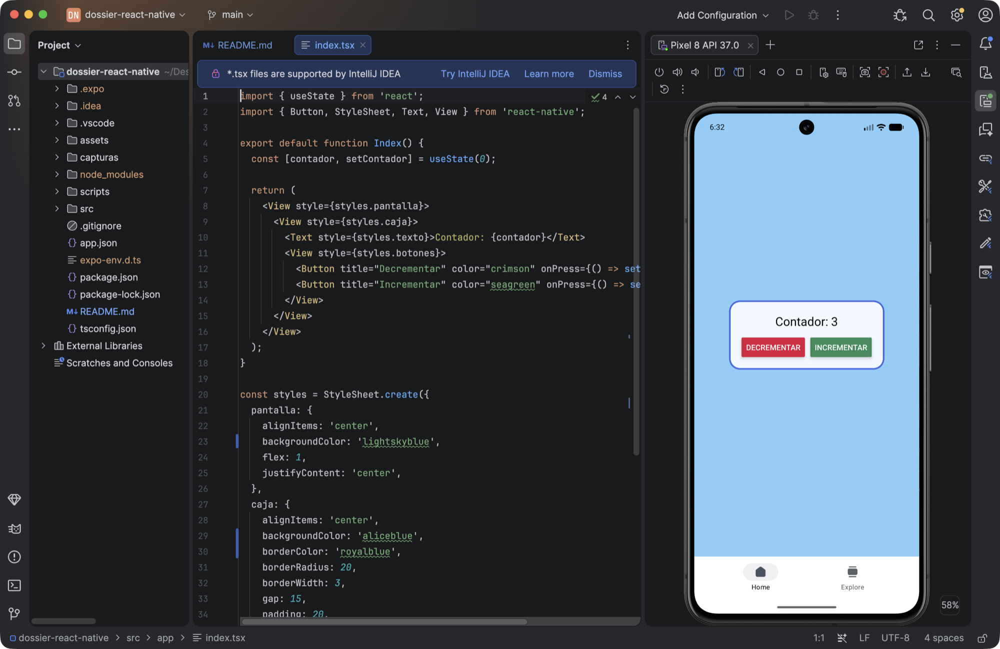

### Problemas que tuve
- Ninguno con el código. Lo único fue preparar el emulador en el portátil: le faltaba la imagen de Android y la tuve que volver a descargar.

### Estado
Terminada.

---

## Práctica 3. InicioScreen y estilos separados

### Qué hay que hacer
Pasar el contador de la práctica 2 a su propia pantalla, `src/screens/InicioScreen.tsx`, y que `src/app/index.tsx` solo la importe y la muestre. Los estilos con `StyleSheet.create()`.

### Cómo lo he hecho
1. Creé la carpeta `src/screens/`.
2. Moví el código del contador a `src/screens/InicioScreen.tsx` y cambié el nombre de la función a `InicioScreen`.
3. Recuperé el Hola mundo de la práctica 1 y lo guardé en `src/screens/HolaMundoScreen.tsx`, para no perderlo.
4. Dejé `src/app/index.tsx` así:

```tsx
import InicioScreen from '../screens/InicioScreen';

export default function Index() {
  return <InicioScreen />;
}
```

Así `src/app/` queda para las rutas de Expo Router y el código de cada pantalla va en `src/screens/`.

Luego, en la práctica 4, el `index.tsx` pasó a ser el índice, y ahora esta pantalla se abre desde `practica02.tsx` (en el índice sale como «Prácticas 2 y 3»).

### Captura


### Problemas que tuve
- Ninguno. Comprobé que no había errores al importar y que el contador seguía sumando y restando igual.

### Estado
Terminada.

---

## Práctica 4. Tres cajas

### Qué hay que hacer
Una pantalla `PrincipalScreen` con el texto «Contenedor Principal» y un escenario con `flex: 1` donde van tres componentes `Caja` de 100 × 100, cada uno con un color que le paso por propiedades.

### Cómo lo he hecho
1. Hice el componente `src/components/Caja.tsx` con dos props: `nombre` y `bg`, que es el color y por defecto es verde. Con `style={[styles.caja, { backgroundColor: bg }]}` junto el estilo base con el color que le llega.
2. En `src/screens/PrincipalScreen.tsx` puse el título en amarillo y el escenario gris claro con `flex: 1`. Dentro van las tres cajas:

```tsx
<View style={styles.escenario}>
  <Caja nombre="1" bg="rosybrown" />
  <Caja nombre="2" bg="cornflowerblue" />
  <Caja nombre="3" bg="green" />
</View>
```

3. Las cajas salen una debajo de otra porque en React Native la columna es la dirección que viene por defecto.
4. Aquí también monté el índice de prácticas (lo explico arriba, en «Cómo está organizado el proyecto»).

### Captura
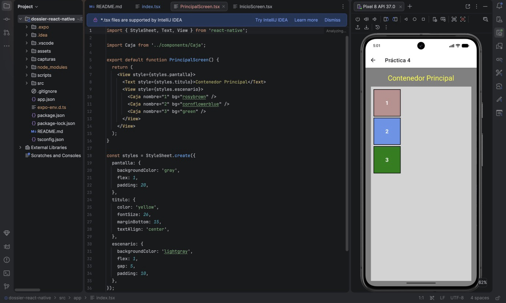

### Problemas que tuve
- Al cambiar las pestañas por el `Stack`, Expo Go seguía enseñando la versión vieja con las pestañas. Se arregló recargando la app.

### Estado
Terminada.

---

## Práctica 5. Modificar flex dinámicamente

### Qué hay que hacer
Ponerle a cada caja dos botones, uno que sube su `flex` y otro que lo baja, enseñar el valor y ver cómo se reparte el espacio. Cada caja con su propio estado y sin valores negativos.

### Cómo lo he hecho
1. Hice otro componente, `src/components/CajaFlex.tsx`, para no romper la práctica 4. Esta caja no tiene altura fija, porque con `height: 100` el `flex` casi no se nota (lo avisa el dossier).
2. Cada caja tiene su propio estado, `const [valorFlex, setValorFlex] = useState(1);`, y se lo paso al estilo: `{ backgroundColor: bg, flex: valorFlex }`.
3. Los botones hacen `setValorFlex(n => n + 1)` y `setValorFlex(n => Math.max(0, n - 1))`. Con el `Math.max` nunca baja de 0.
4. La pantalla es `src/screens/FlexScreen.tsx`, con las tres cajas en el escenario.

### Capturas
Al entrar, las tres tienen `flex: 1` y ocupan lo mismo:

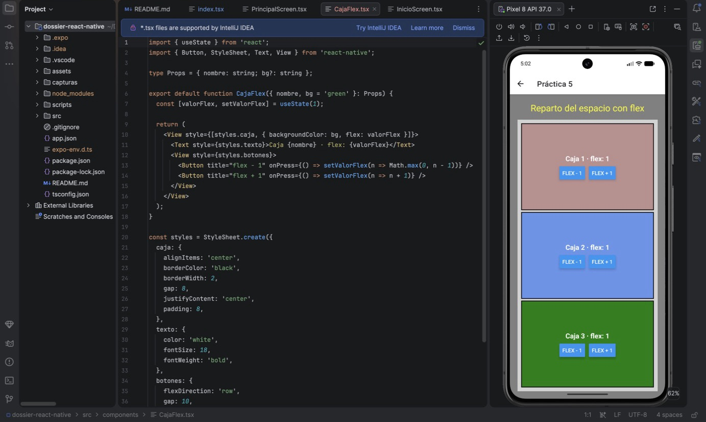

Después de subir la caja 2 a `flex: 3` y bajar la 3 a `flex: 0`, la 2 se queda con la mayor parte del espacio (unas tres veces lo de la 1) y la 3 solo ocupa lo que mide su contenido:

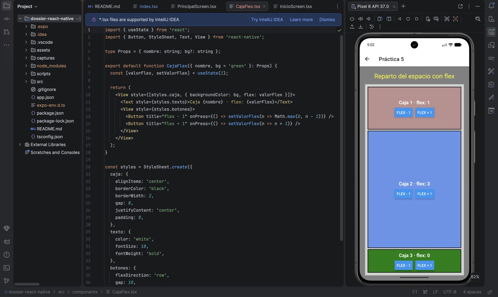

### Problemas que tuve
- Ninguno. Me fijé en que con `flex: 0` la caja no desaparece: se queda del tamaño del texto y los botones, así que se puede volver a subir.

### Estado
Terminada.

---

## Práctica 6. Sustituir los botones

### Qué hay que hacer
Cambiar los botones de la práctica 5. El de `flex + 1` pasa a ser un `TouchableHighlight` que además saca una alerta, y el de `flex - 1` un `TouchableOpacity`. Los dos personalizados.

### Cómo lo he hecho
1. Copié la caja en `src/components/CajaTactil.tsx` (así la práctica 5 sigue igual) y cambié los `Button` por los dos componentes táctiles, cada uno con un `Text` dentro.
2. El `TouchableOpacity` es rojo y baja el valor. Al pulsarlo se vuelve medio transparente.
3. El `TouchableHighlight` es naranja y lleva `underlayColor="gold"`, que es el color que sale mientras lo tienes pulsado.
4. La función `aumentar` saca la alerta y luego sube el valor:

```tsx
const aumentar = () => {
  Alert.alert('flex + 1', `La caja ${nombre} pasa a flex ${valorFlex + 1}`);
  setValorFlex(n => n + 1);
};
```

5. Los dos botones van redondeados (`borderRadius: 20`) y con borde blanco.
6. La pantalla es `src/screens/TactilScreen.tsx`, con las tres cajas como en la 5.

### Capturas
La alerta al pulsar `flex + 1` en la caja 2:

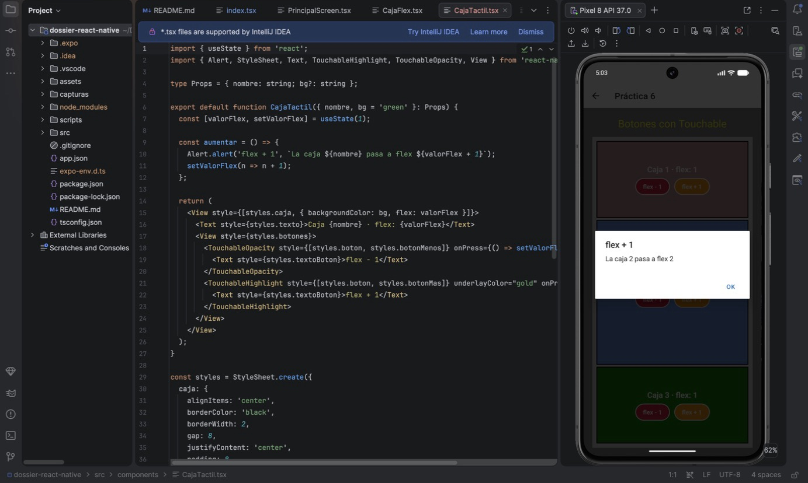

Después de cerrar la alerta y bajar la caja 1 a `flex: 0`:

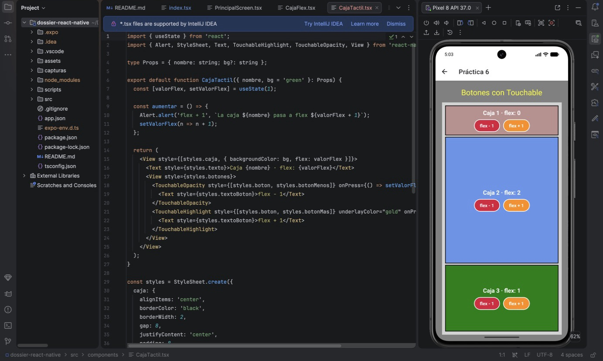

### Problemas que tuve
- Ninguno. La diferencia entre los dos se nota al pulsar: el Highlight cambia de color y el Opacity solo se aclara.

### Estado
Terminada.

---

## Práctica 7. Nombre y estilos personalizados

### Qué hay que hacer
Que cada caja enseñe su nombre (Caja A, B y C) y acepte estilos que le llegan por propiedades. Al menos una con las esquinas redondeadas y otro borde.

### Cómo lo he hecho
1. Hice el componente `src/components/CajaPersonalizada.tsx` con una prop `style` de tipo `StyleProp<ViewStyle>`:

```tsx
type Props = { nombre: string; bg?: string; style?: StyleProp<ViewStyle> };
```

2. Dentro de la caja junto los estilos así: `style={[styles.porDefecto, { backgroundColor: bg, flex: valorFlex }, style]}`. El último es el que manda, así que lo que le paso desde fuera pisa al estilo por defecto.
3. En `src/screens/CajasPersonalizadasScreen.tsx`:
   - la Caja A va con el estilo por defecto;
   - la B lleva `borderRadius: 20` y un borde azul marino de 7;
   - la C lleva `borderRadius: 40` y un borde amarillo discontinuo (`borderStyle: 'dashed'`).
4. Los botones son los de la práctica 6, así que siguen funcionando.

### Captura
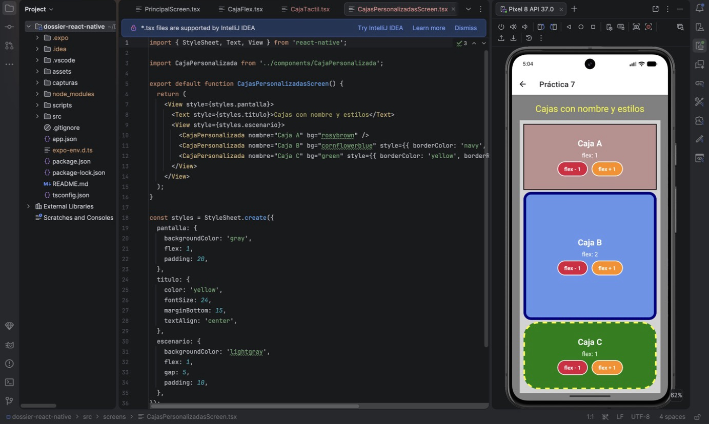

### Problemas que tuve
- Ninguno.

### Estado
Terminada.

---

## Práctica 8. Círculos dinámicos

### Qué hay que hacer
Empezar con el escenario vacío. Un botón añade círculos de un color que va cambiando, y otros dos cambian entre `wrap/nowrap` y `row/column`. Los botones tienen que ser personalizados con `TouchableOpacity` y el RGB no puede pasar de 255.

### Cómo lo he hecho
1. Hice un botón reutilizable, `src/components/BotonPersonalizado.tsx`: un `TouchableOpacity` con un título y un color que le paso por props.
2. En `src/screens/CirculosScreen.tsx` guardo los círculos en un array de estado. Cada círculo tiene `id` y `color`.
3. El color depende del número del círculo. Lo limito con `Math.min(255, ...)` y, en el verde, que va bajando, también con `Math.max(0, ...)`:

```ts
const rojo = Math.min(255, 120 + numero * 12);
const verde = Math.max(0, Math.min(255, 230 - numero * 8));
const azul = Math.min(255, 140 + (numero % 5) * 25);
```

4. Otros dos estados guardan el `flexWrap` y el `flexDirection` y se los paso al escenario. Cada botón enseña el valor que tiene puesto, como en la figura del dossier («wrap. Pulse para cambiar»).
5. Los círculos los pinto con `map` y a cada uno le pongo `key={circulo.id}`, porque React lo necesita.

### Capturas
Con `wrap` y `row`, cuando no caben más en la fila bajan a la siguiente:

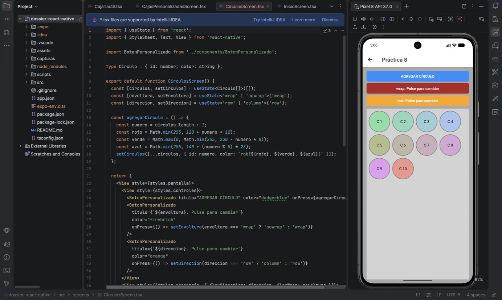

Con `nowrap` y `column` salen todos en una columna y los últimos se quedan fuera, porque no pueden saltar a otra columna:

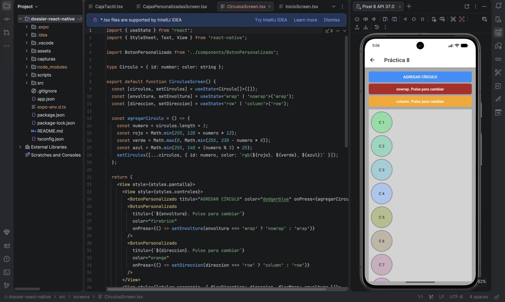

### Problemas que tuve
- Ninguno. Al escenario le puse `overflow: 'hidden'` para que, con `nowrap`, los círculos que no caben se corten en el borde y no se salgan por encima de lo demás.

### Estado
Terminada.

---

## Práctica 9. Distribución, alineación e imágenes

### Qué hay que hacer
Una pantalla con un campo de texto para elegir un valor válido de `justifyContent`, botones para cambiar `alignItems` y tres imágenes, al menos una del proyecto con `require`. El escenario con `flexWrap: 'nowrap'` y la alineación activa escrita en pantalla.

### Cómo lo he hecho
1. Puse los valores válidos en un array y saqué el tipo de ahí. Así TypeScript sabe que solo pueden ser esos y no da problemas al ponerlos en el estilo:

```ts
const valoresJustify = ['flex-start', 'center', 'flex-end', 'space-between', 'space-around', 'space-evenly'] as const;
type Justify = (typeof valoresJustify)[number];
```

2. El `TextInput` está controlado con el estado `texto`. Solo cambio el `justifyContent` si lo que escribo está en la lista. Si no, sale un aviso en rojo con los valores que valen y se queda el último que era correcto.
3. Tres botones (`flex-start`, `center` y `flex-end`) cambian el `alignItems`. El que está puesto sale en azul más oscuro.
4. Las imágenes son tres:
   - el logo de React del proyecto, con `require('../../assets/images/react-logo.png')`;
   - el logo pequeño de la web de React Native, con `{ uri: ... }`;
   - el logo de Expo de GitHub, también con `{ uri: ... }`.
5. Encima del escenario se ve lo que hay puesto, por ejemplo `justifyContent: space-between · alignItems: flex-end`.
6. La pantalla es `src/screens/AlineacionScreen.tsx`. El escenario tiene `flexDirection: 'column'` y `flexWrap: 'nowrap'`, como pide el dossier.

### Capturas
Con `center` en los dos:

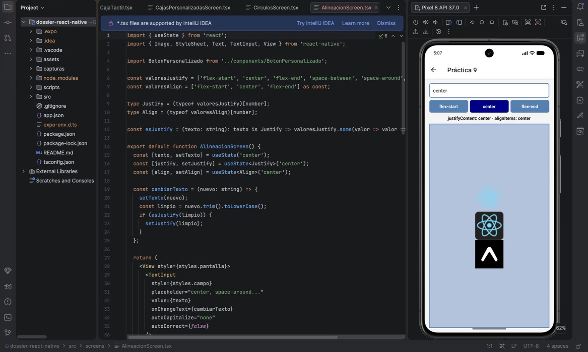

Escribiendo `space-between` y pulsando `flex-end`:

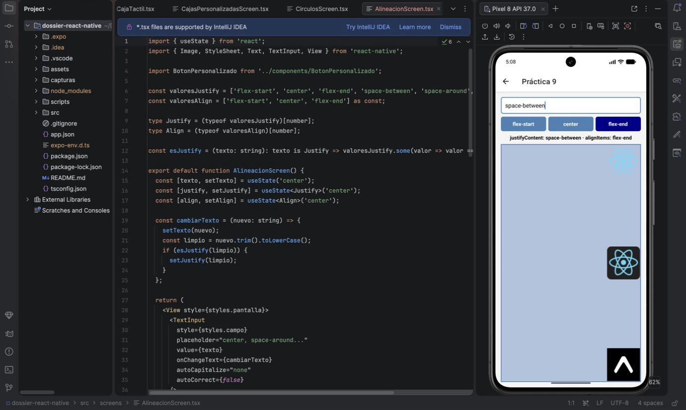

### Problemas que tuve
- La tercera imagen al principio era una foto de picsum.photos, pero no cargaba porque la web no respondía. La cambié por el logo de Expo de GitHub, que sí carga. Es lo que avisa el dossier: las URL de fuera pueden fallar.
- Al escribir en el campo, mientras pones el valor a medias (por ejemplo `space-`) sale el aviso rojo. Es normal: desaparece cuando el valor ya es válido.

### Estado
Terminada.

---

## Práctica 9.1. Imagen aleatoria

### Qué hay que hacer
Con una colección de imágenes locales, un botón que elige una al azar con `Math.floor(Math.random() * imagenes.length)` y guarda la posición con `useState`.

### Cómo lo he hecho
1. Hice una lista con tres imágenes que elegí yo y guardé en `assets/images`: Lamine Yamal, Ka-Chow! y Kilian Dictad*r. Cada `require` va escrito entero, porque la ruta de `require` no se puede montar con una variable.

```tsx
const imagenes = [
  { nombre: 'Lamine Yamal', source: require('../../assets/images/celebracion-corner.jpg') },
  { nombre: 'Ka-Chow!', source: require('../../assets/images/rayo-mcqueen.jpg') },
  { nombre: 'Kilian Dictad*r', source: require('../../assets/images/uniforme-militar.jpg') },
];
```

2. La posición va en un estado y la imagen que se ve es `imagenes[indice]`.
3. El botón `IMAGEN ALEATORIA` hace `setIndice(Math.floor(Math.random() * imagenes.length))`.
4. Debajo de la imagen sale su nombre y la posición, por ejemplo «Ka-Chow! (2 de 3)».
5. La pantalla es `src/screens/ImagenAleatoriaScreen.tsx`.

### Capturas
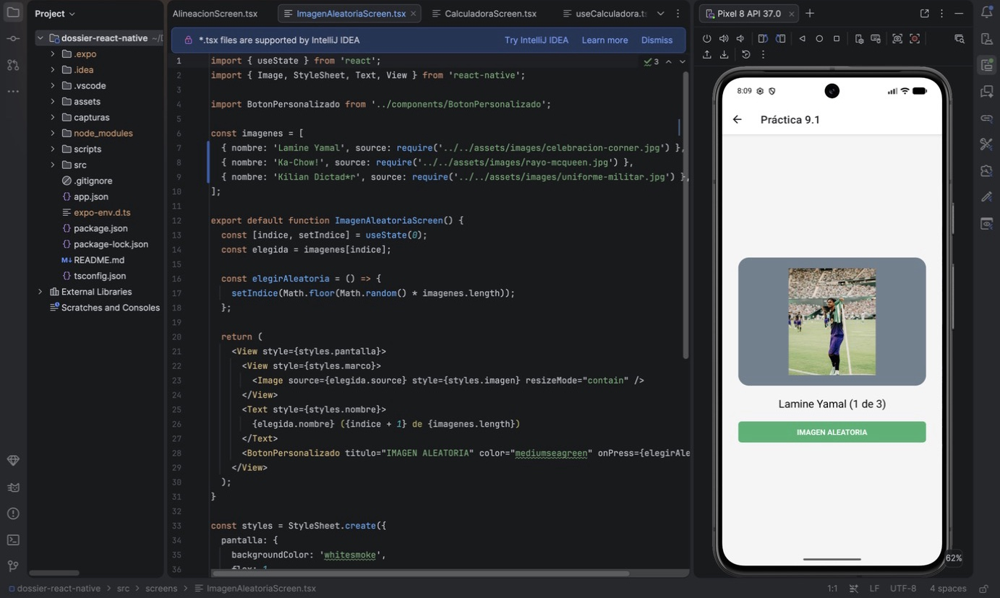


### Problemas que tuve
- Al principio puse cinco imágenes que venían con la plantilla de Expo, y después las cambié por tres que elegí yo.
- Si sale la misma imagen dos veces seguidas es normal, porque es al azar.

### Estado
Terminada.

---

## Práctica 10. Calculadora

### Qué hay que hacer
Copiar la calculadora de la figura del dossier: la pantalla del resultado y las filas de teclas. Las teclas tienen que ser un componente reutilizable con `TouchableOpacity`, las filas con Flexbox y el resultado en un estado. Sin usar `eval`.

### Cómo lo he hecho
1. `src/components/TeclaCalculadora.tsx`: cada tecla es un `TouchableOpacity` redondo (`aspectRatio: 1` y `borderRadius: 100`). Tiene props para el texto, el color, el color del texto y si es ancha, que es la del 0. El 0 no lleva `aspectRatio` (lo explico en los problemas).
2. `src/screens/CalculadoraScreen.tsx`: cinco filas con `flexDirection: 'row'` y `gap`. Los colores son como en la figura: gris claro para AC, ± y %, naranja para las operaciones y gris oscuro para los números.
3. Uso cuatro estados:
   - `pantalla`: lo que se ve;
   - `anterior`: el primer número;
   - `operacion`: la operación que está pendiente;
   - `esperando`: si el siguiente número tiene que empezar de cero.
4. Las cuentas las hace la función `calcular` con un `switch`, nada de `eval`:

```ts
const calcular = (a: number, b: number, operacion: Operacion) => {
  switch (operacion) {
    case '+':
      return a + b;
    case '-':
      return a - b;
    case 'x':
      return a * b;
    case '/':
      return b === 0 ? NaN : a / b;
  }
};
```

5. Si encadenas operaciones (por ejemplo `2 + 3 x 4 =`), va haciendo la cuenta sobre la marcha y da 20. Arriba, en pequeño, sale la operación pendiente (`125 /`).
6. El resultado lleva `numberOfLines={1}` y `adjustsFontSizeToFit` para que los números largos quepan en una línea.
7. Si pulsas ± justo después de una operación, el número que vas a escribir empieza en negativo (`-0`), como en la calculadora del móvil.

### Capturas
Escribiendo `125 / 4`:

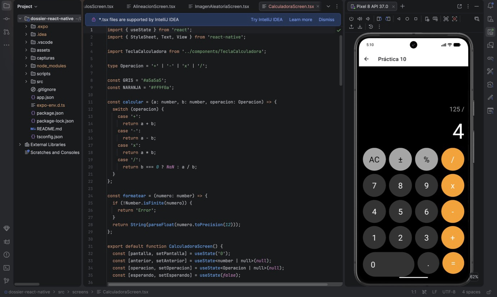

Al pulsar `=`, con la primera versión de `TeclaCalculadora` abierta en el editor:

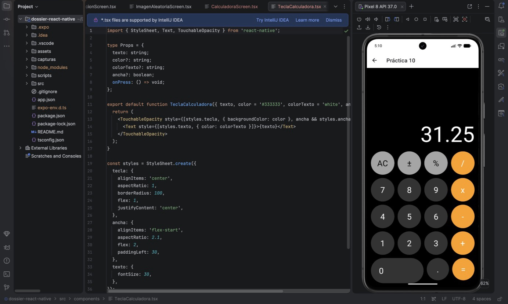

### Problemas que tuve
- Los decimales en JavaScript no son exactos: `0.1 + 0.2` da `0.30000000000000004`. Para que salga `0.3` redondeo el resultado con `toPrecision(12)` y le quito los ceros del final con `parseFloat`.
- En JavaScript dividir entre 0 da `Infinity`. Si el segundo número es 0 devuelvo `NaN`, y `formatear` enseña «Error» cuando el número no es finito. Al pulsar otro número se empieza de nuevo.
- Al principio, si después del Error pulsabas otra operación (`5 / 0 +`), se quedaba guardado el `NaN` y todo lo siguiente salía Error. Ahora, cuando sale Error, borro también el número anterior y la operación.
- Al 0 primero le puse `flex: 2` y `aspectRatio: 2.1` (es lo que se ve en la segunda captura), pero quedaba un poco más alto que las demás teclas y el `.` y el `=` salían más pequeños. Lo cambié: el 0 ya no lleva `aspectRatio`, sino `flexGrow: 2` y `flexBasis: 12`, que es lo que mide el `gap`. Así ocupa dos teclas más el hueco de en medio y se estira a la altura de la fila. El hueco de la izquierda del 0 lo puse con `marginLeft` en el texto, porque con `paddingLeft` en la tecla el `.` y el `=` seguían saliendo más pequeños.

Lo probé con `0.1 + 0.2` (sale 0.3), `5 / 0` (sale Error), `5 / 0 + 3 =` (sale Error y luego 3), `2 + 3 x 4` (sale 20), `9 ± x 2` (sale -18), `9 x ± 4` (sale -36) y `50 %` (sale 0.5).

### Estado
Terminada.

---

## Práctica 11. Hook personalizado para la calculadora

### Qué hay que hacer
Sacar de la calculadora los estados y las funciones que no son JSX a un hook, `src/hooks/useCalculadora.ts`. La pantalla importa el hook y usa lo que devuelve, y la calculadora tiene que seguir funcionando igual.

### Cómo lo he hecho
1. Creé `src/hooks/useCalculadora.ts` y pasé ahí los cuatro estados (`pantalla`, `anterior`, `operacion` y `esperando`) y las funciones de las teclas (`pulsarNumero`, `pulsarOperacion`, `pulsarIgual`, `limpiar`, `cambiarSigno` y `porcentaje`). También moví `calcular` y `formatear`.
2. El hook es una función que empieza por `use` y devuelve un objeto con lo que necesita la pantalla:

```ts
export default function useCalculadora() {
  const [pantalla, setPantalla] = useState('0');
  const [anterior, setAnterior] = useState<number | null>(null);
  const [operacion, setOperacion] = useState<Operacion | null>(null);
  const [esperando, setEsperando] = useState(false);

  ...

  const operacionPendiente = operacion !== null && anterior !== null ? `${formatear(anterior)} ${operacion}` : ' ';

  return {
    cambiarSigno,
    limpiar,
    operacionPendiente,
    pantalla,
    porcentaje,
    pulsarIgual,
    pulsarNumero,
    pulsarOperacion,
  };
}
```

3. `esperando`, `anterior` y `operacion` no los devuelvo, porque solo los usan las funciones de dentro del hook. En su lugar devuelvo `operacionPendiente`, el texto pequeño de arriba (por ejemplo `125 /`), que el hook ya prepara con `formatear`.
4. En `src/screens/CalculadoraScreen.tsx` ya solo quedan el JSX, los colores y los estilos. Arriba saco lo que necesito con desestructuración:

```tsx
const {
  cambiarSigno,
  limpiar,
  operacionPendiente,
  pantalla,
  porcentaje,
  pulsarIgual,
  pulsarNumero,
  pulsarOperacion,
} = useCalculadora();
```

5. `calcular` y `formatear` se quedan dentro del archivo del hook y no los exporto, así la pantalla solo usa lo que devuelve `useCalculadora`. Arriba pone `<Text style={styles.operacion}>{operacionPendiente}</Text>`.
6. Como es la misma calculadora, la 10 y la 11 van juntas en `practica10.tsx`, y en el índice sale como «Prácticas 10 y 11».

### Capturas
El hook abierto en el editor, con la calculadora funcionando igual que antes:

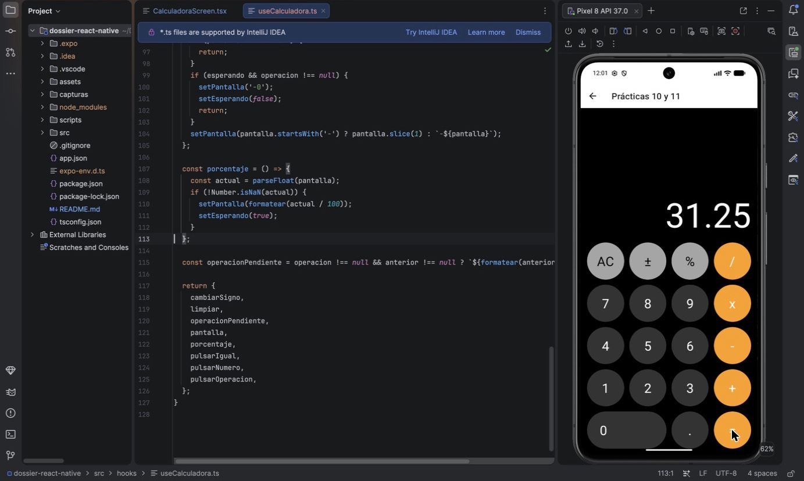

La pantalla, que ya solo tiene el JSX:

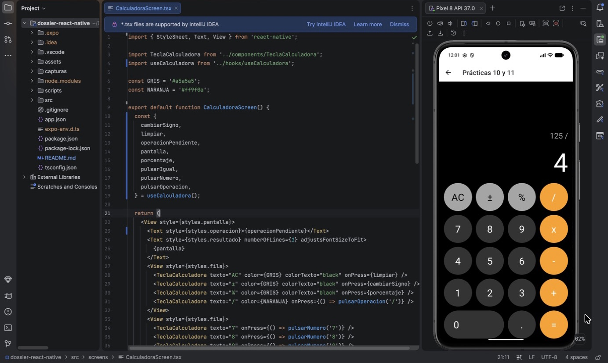

### Problemas que tuve
- Al principio la pantalla importaba `formatear` aparte para escribir la operación pendiente, pero el dossier pide que la pantalla use lo que devuelve el hook. Lo cambié para que el hook devuelva ese texto ya hecho (`operacionPendiente`).
- Repetí las pruebas de la práctica 10 (`0.1 + 0.2`, `5 / 0 + 3 =`, `2 + 3 x 4`, `9 x ± 4`, `50 %` y `125 / 4`) y salen los mismos resultados.

### Estado
Terminada.

---

## Práctica 12. Color aleatorio con confirmación

### Qué hay que hacer
Una pantalla con un botón «Cambiar de color». Al pulsarlo se elige un color al azar de una lista y sale una alerta diciendo cuál se propone. Si aceptas, cambia el fondo; si cancelas, se queda el que había.

### Cómo lo he hecho
1. La pantalla es `src/screens/ColorAleatorioScreen.tsx`. El color del fondo va en un estado, `fondo`, que empieza en `white`.
2. Tengo una lista de colores (`lightblue`, `lightgreen`, `gold`, `orange`, `pink`, `plum`, `salmon` y `turquoise`). Antes de elegir quito el que ya está puesto, para que no te proponga el mismo:

```tsx
const cambiarColor = () => {
  const otros = colores.filter(color => color !== fondo);
  const propuesto = otros[Math.floor(Math.random() * otros.length)];
  Alert.alert('Cambiar de color', `¿Quieres poner el fondo de color ${propuesto}?`, [
    { text: 'Cancelar', style: 'cancel' },
    { text: 'Aceptar', onPress: () => setFondo(propuesto) },
  ]);
};
```

3. Solo el botón «Aceptar» cambia el estado. «Cancelar» no tiene `onPress`, así que el fondo se queda igual.
4. El botón es el `BotonPersonalizado` de la práctica 8, y encima sale escrito el color que hay puesto.

### Capturas
La alerta proponiendo un color:

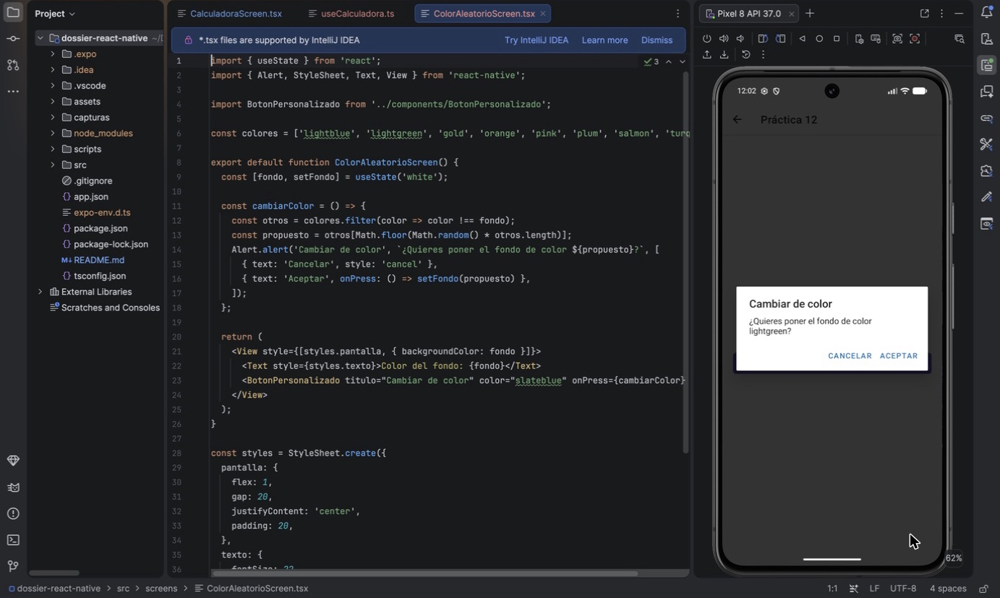

Después de pulsar «Aceptar»:

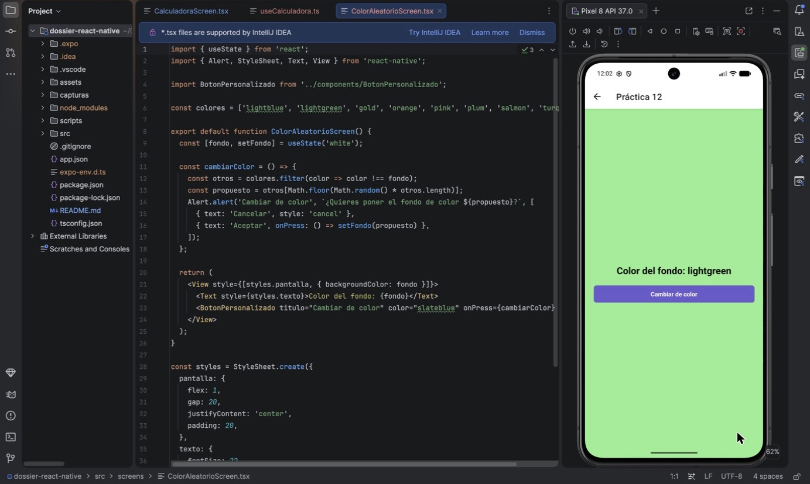

### Problemas que tuve
- Ninguno con el código. En Android los botones de la alerta salen en mayúsculas (CANCELAR y ACEPTAR) aunque yo los escribí como «Cancelar» y «Aceptar»; es el estilo de Android.

### Estado
Terminada.

---

## Práctica 13. Introducir el color

### Qué hay que hacer
Lo mismo que la 12, pero escribiendo el color en un diálogo. Como `Alert.prompt()` no funciona igual en Android, el diálogo se hace con un `Modal`, un `TextInput` y dos botones (Cancelar y Aceptar). Solo se cambia el fondo si el color es válido, y si cancelas no cambia nada.

### Cómo lo he hecho
1. Hice el componente `src/components/DialogoTexto.tsx`: un `Modal` transparente con el fondo oscurecido y una caja blanca con el título, el `TextInput`, un texto rojo para los errores y los dos botones. Todo le llega por props (`visible`, `titulo`, `valor`, `placeholder`, `error`, `onChangeText`, `onCancelar` y `onAceptar`), así me sirve para pedir cualquier texto.
2. La pantalla es `src/screens/IntroducirColorScreen.tsx`. Tiene cuatro estados: `fondo`, `visible` (si el diálogo está abierto), `colorEscrito` y `error`.
3. Para saber si el color es válido uso `processColor` de React Native, que devuelve `undefined` cuando no entiende el color:

```tsx
const aceptar = () => {
  const color = colorEscrito.trim().toLowerCase();
  if (color === '') {
    setError('Escribe un color');
    return;
  }
  const procesado = processColor(color);
  if (procesado === null || procesado === undefined) {
    setError(`«${colorEscrito.trim()}» no es un color válido`);
    return;
  }
  setFondo(color);
  setVisible(false);
};
```

4. Valen los nombres de colores en inglés (`tomato`) y en hexadecimal (`#ffcc00`). Lo paso a minúsculas, así `Tomato` también funciona.
5. «Cancelar» solo cierra el diálogo (`setVisible(false)`), y el botón de atrás de Android también, por el `onRequestClose` del `Modal`.

### Capturas
Escribiendo un color que no existe:

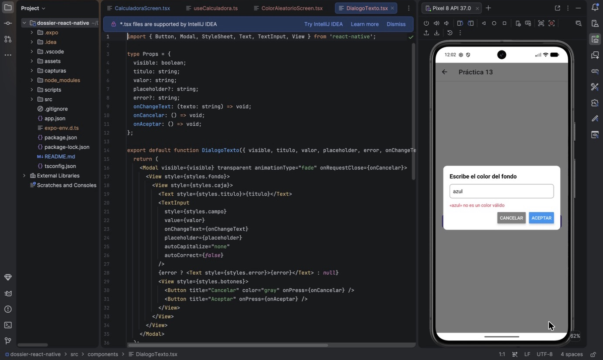

Con `#ffcc00` aceptado:

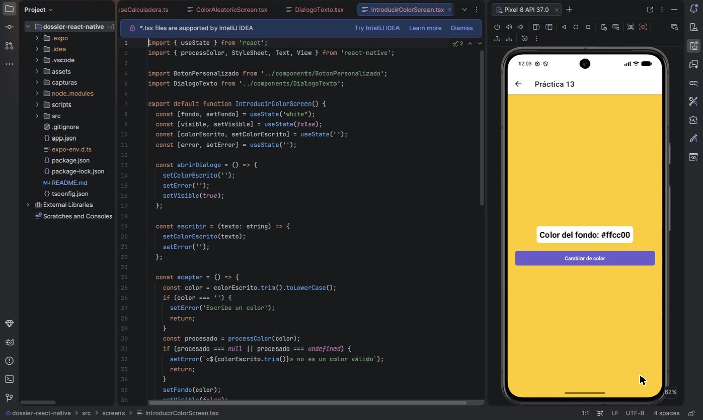

### Problemas que tuve
- Al principio el aviso de error se quedaba puesto mientras escribías otra cosa. Lo arreglé con una función `escribir` que guarda el texto y borra el error a la vez.
- `azul` no vale: los nombres de los colores tienen que ir en inglés.
- Con un color oscuro (por ejemplo `navy`) el texto negro de «Color del fondo» no se leía, así que le puse a ese texto un fondo blanco con las esquinas redondeadas.

### Estado
Terminada.

---

## Práctica 14. Borde activado por Switch

### Qué hay que hacer
Copiar el `Switch` de referencia: el indicador marrón cuando está apagado y naranja cuando está encendido. Al encenderlo sale un borde rojo alrededor de la pantalla y al apagarlo se quita.

### Cómo lo he hecho
1. La pantalla es `src/screens/SwitchBordeScreen.tsx`, con un estado `activo` que empieza en `false`.
2. El `Switch` va conectado con `value` y `onValueChange`, y el color del indicador cambia con `thumbColor`:

```tsx
<Switch
  style={styles.switch}
  value={activo}
  onValueChange={setActivo}
  thumbColor={activo ? 'orange' : 'brown'}
  trackColor={{ false: 'tan', true: 'moccasin' }}
/>
```

3. Con `trackColor` le puse a la barra colores claros que pegan con el marrón y el naranja.
4. El borde va en un estilo aparte que solo se añade si `activo` es `true`: `style={[styles.pantalla, activo && styles.borde]}`, con `borderColor: 'red'` y `borderWidth: 10`.
5. Arriba pone «Borde activado» o «Borde desactivado», y el `Switch` lo agrandé con `transform: [{ scale: 1.5 }]` para que se vea mejor.

### Capturas
Apagado, sin borde:

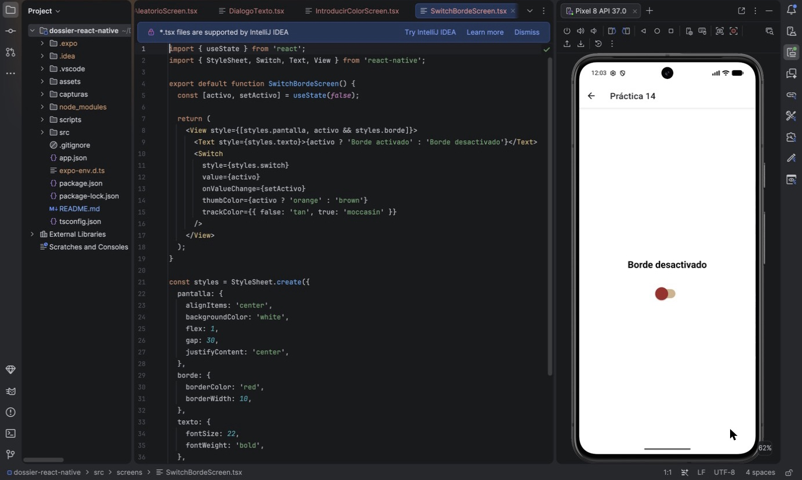

Encendido, con el borde rojo:

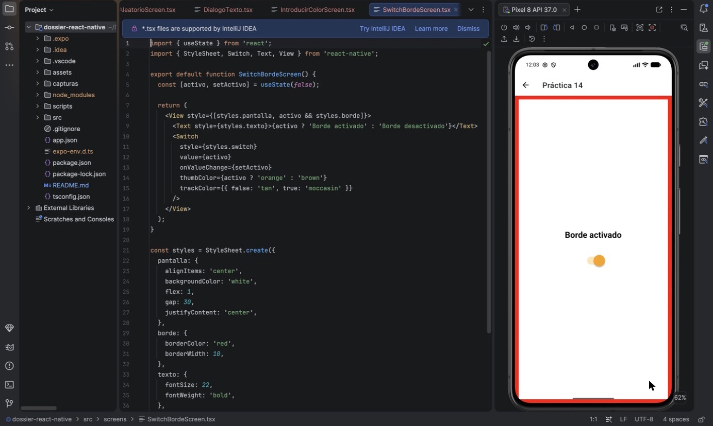

### Problemas que tuve
- La pantalla no tenía color de fondo y, con el móvil en modo oscuro, el texto negro no se veía. Le puse `backgroundColor: 'white'` como en las demás prácticas.

### Estado
Terminada.

---

## Práctica 15. Completar el formulario

### Qué hay que hacer
Hacer el formulario de persona del ejemplo (nombre, edad y jubilado) y añadirle el `Switch` de `casado`. Los cuatro campos tienen que actualizar el estado y salir en un resumen al final.

### Cómo lo he hecho
1. La pantalla es `src/screens/FormularioPersonaScreen.tsx`. Los datos van todos en un estado con su tipo. La edad la guardo como texto, porque el `TextInput` siempre devuelve texto, y la paso a número al validar:

```tsx
type DatosPersona = {
  nombre: string;
  edad: string;
  casado: boolean;
  jubilado: boolean;
};
```

2. Para no hacer una función por campo uso `cambiarCampo`, como en el dossier. Con `K extends keyof DatosPersona` solo deja poner campos que existen, y el valor tiene que ser del tipo de ese campo:

```tsx
function cambiarCampo<K extends keyof DatosPersona>(campo: K, valor: DatosPersona[K]) {
  setDatos(actual => ({ ...actual, [campo]: valor }));
  setResumen(null);
}
```

3. Los dos `TextInput` y los dos `Switch` llaman a `cambiarCampo`, por ejemplo `onValueChange={valor => cambiarCampo('casado', valor)}`. El de la edad lleva `keyboardType="numeric"`.
4. Al pulsar «Enviar» compruebo que el nombre no esté vacío y que la edad sea un número entero entre 0 y 130. Para la edad uso una expresión regular, `/^\d+$/`, que solo deja pasar dígitos, y luego miro que no pase de 130. Si algo falla sale una alerta; si está bien, guardo los datos en otro estado, `resumen`, y salen abajo en una caja: nombre, edad, casado (Sí/No) y jubilado (Sí/No).
5. Si cambias algún campo después de enviar, el resumen se quita hasta que vuelvas a enviar, para que no enseñe datos viejos.

### Capturas
La alerta cuando la edad no es válida (`25.5`):

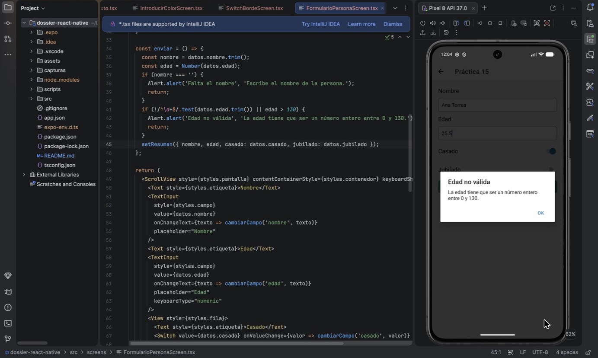

El formulario enviado, con el resumen de los cuatro campos:

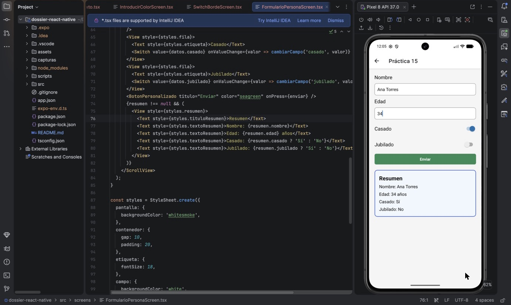

### Problemas que tuve
- Con `keyboardType="numeric"` el teclado deja escribir decimales y el signo menos, así que hay que validar igualmente.
- Al principio lo comprobaba con `Number.isInteger(Number(datos.edad))`, pero `Number('25.')` da 25 y la daba por buena, y `Number('')` da 0. Lo cambié por la expresión regular, que solo acepta dígitos.
- Las etiquetas salían en negro y, con el móvil en modo oscuro, el fondo de la pantalla se ponía casi negro y no se leían. Le puse fondo propio al `ScrollView`, como en las otras prácticas.

### Estado
Terminada.

---

## Práctica 16. Lista de productos

### Qué hay que hacer
Cambiar la lista de personas del ejemplo por una lista de productos con nombre, precio y stock. Sin separador, con los colores de fondo alternos usando `index` y la cabecera «Lista Productos» centrada y más grande.

### Cómo lo he hecho
- Los productos son cartas de FC 27 con su precio en monedas y su stock.
- Usé una `FlatList` con `renderItem`, y el color lo cambio con `index % 2 === 0 ? 'white' : 'lightsteelblue'`.
- La cabecera va en `ListHeaderComponent` con `fontSize: 30` y `textAlign: 'center'`.

### Capturas
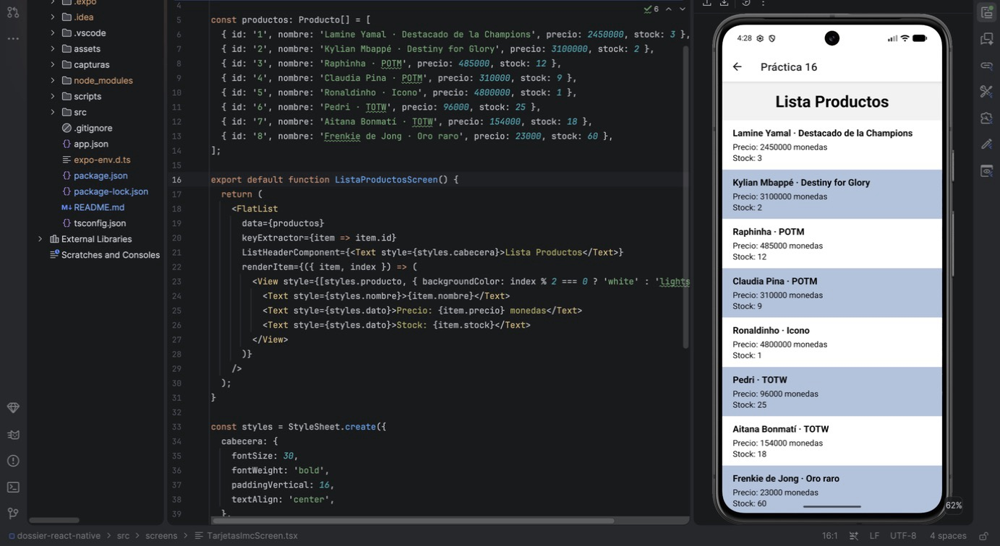

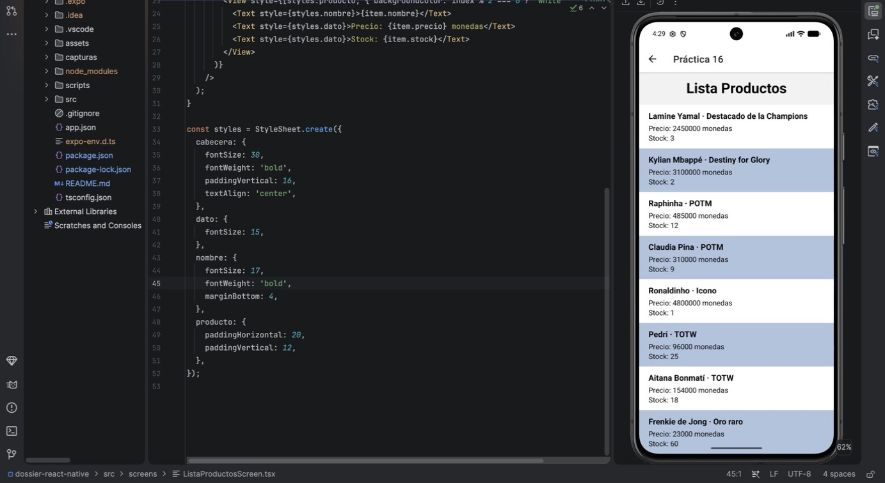

### Problemas que tuve
- Se me coló una «a» delante del primer `import` y salía «Failed to compile». La quité y ya funcionó.

### Estado
Terminada.

---

## Práctica 17. Tarjetas para calcular el IMC

### Qué hay que hacer
Hacer un componente `CardPersona.tsx` con id, nombre, altura y peso que calcule el IMC. La pantalla tiene un botón «+» para añadir tarjetas y cada tarjeta tiene un botón para eliminarla.

### Cómo lo he hecho
- `CardPersona` recibe el `id` y la función `onEliminar` por props, y guarda el nombre, la altura y el peso en su estado.
- El IMC es `kilos / (metros * metros)`, y solo lo calculo si los dos son mayores que 0 para no dividir entre 0.
- En `TarjetasImcScreen` tengo un array de ids. El «+» añade un id nuevo y eliminar lo quita con `filter`.

### Capturas
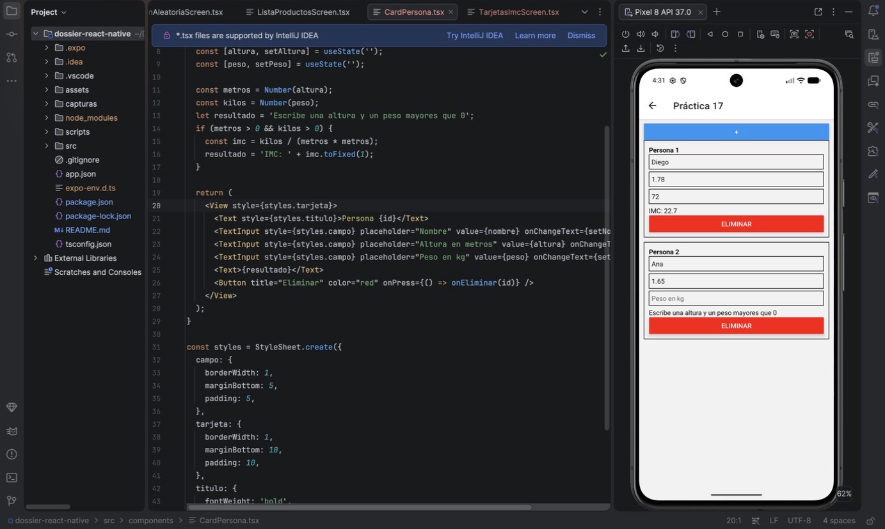

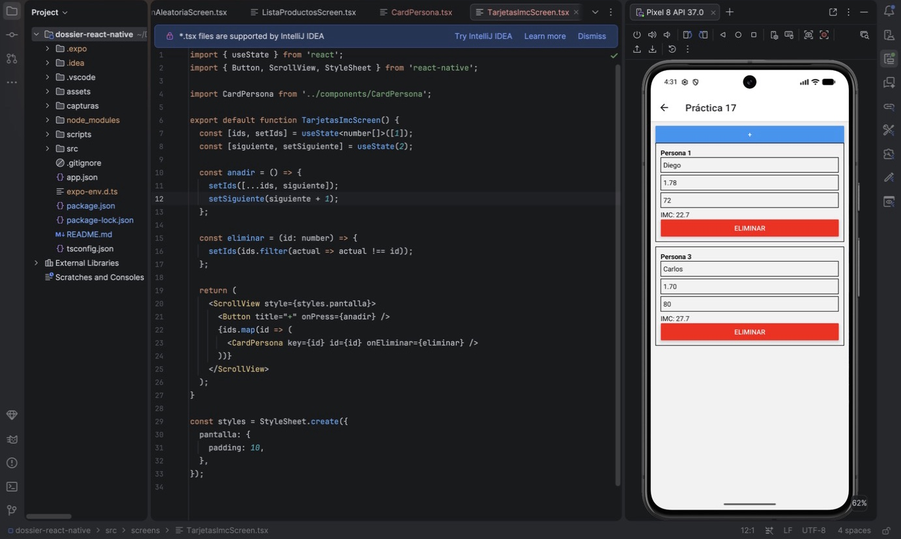

### Problemas que tuve
- Ninguno.

### Estado
Terminada.

---

## Práctica 18. Diario de emociones

### Qué hay que hacer
Una pantalla con un `TextInput` y un botón que va guardando entradas de un diario con el texto, la fecha y la hora con segundos y un icono: sonriente si pone `:-)` y triste si pone `:-(`.

### Cómo lo he hecho
- Instalé los iconos con `npx expo install @expo/vector-icons`.
- Las entradas van en un array del estado y se ven en una `FlatList`.
- La fecha la saco con `new Date().toLocaleString('es-ES')`.
- El icono lo elijo con varios `if` y `texto.includes(...)`. Puse también `:-D`, `;-)` y `:-O`.

### Capturas
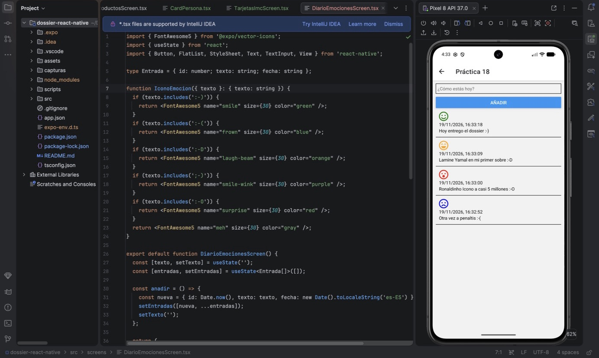

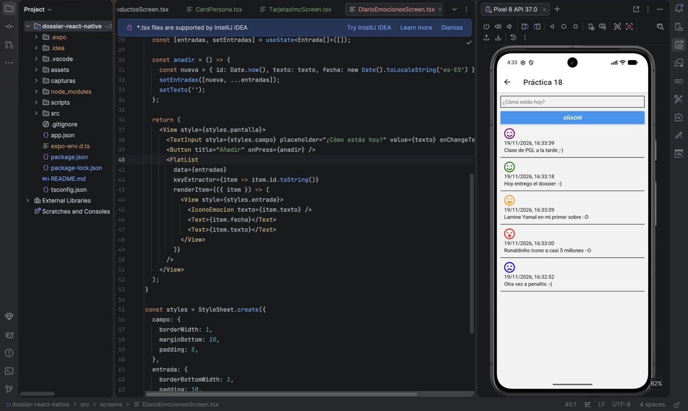

### Problemas que tuve
- No salían los iconos hasta que instalé `@expo/vector-icons`.

### Estado
Terminada.

---

## Práctica 19. Insertar emoticonos en el texto

### Qué hay que hacer
Poner varios iconos de emociones encima de un `TextInput` y que al pulsar uno se añada su secuencia (`:-)`, `:-(`...) al final del texto.

### Cómo lo he hecho
- Cada icono va dentro de un `TouchableOpacity` con `setTexto(actual => actual + ' :-)')`.
- El `TextInput` está controlado con `value={texto}` y `onChangeText={setTexto}`.

### Capturas
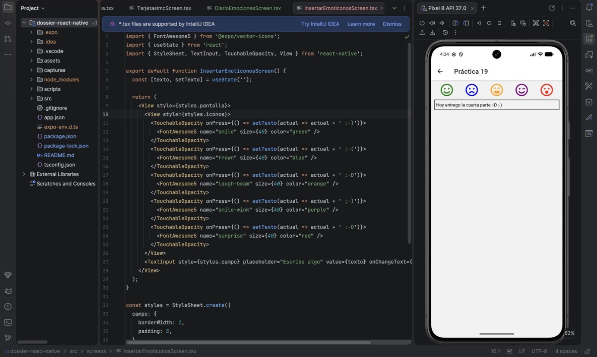

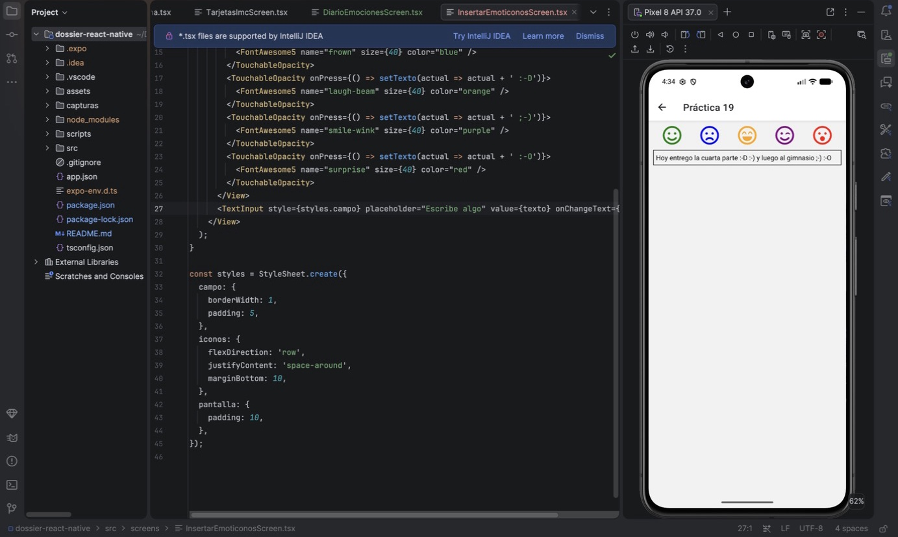

### Problemas que tuve
- Ninguno.

### Estado
Terminada.

---

## Práctica 20. Primer Stack

### Qué hay que hacer
Hacer una HomeScreen que vaya a una segunda pantalla y se pueda volver, todo dentro de `src/app/stack/p20/` y con un enlace desde el índice.

### Cómo lo he hecho
- Creé `src/app/stack/p20/` con `_layout.tsx` (el `Stack`), `index.tsx` (la HomeScreen) y `detalle.tsx`.
- Para ir uso `router.push('/stack/p20/detalle')` y para volver `router.back()`.
- En el `_layout.tsx` principal puse `headerShown: false` en `stack/p20` para que no salgan dos cabeceras.

### Capturas
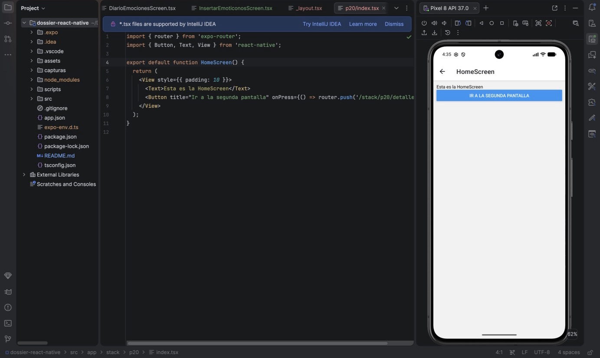

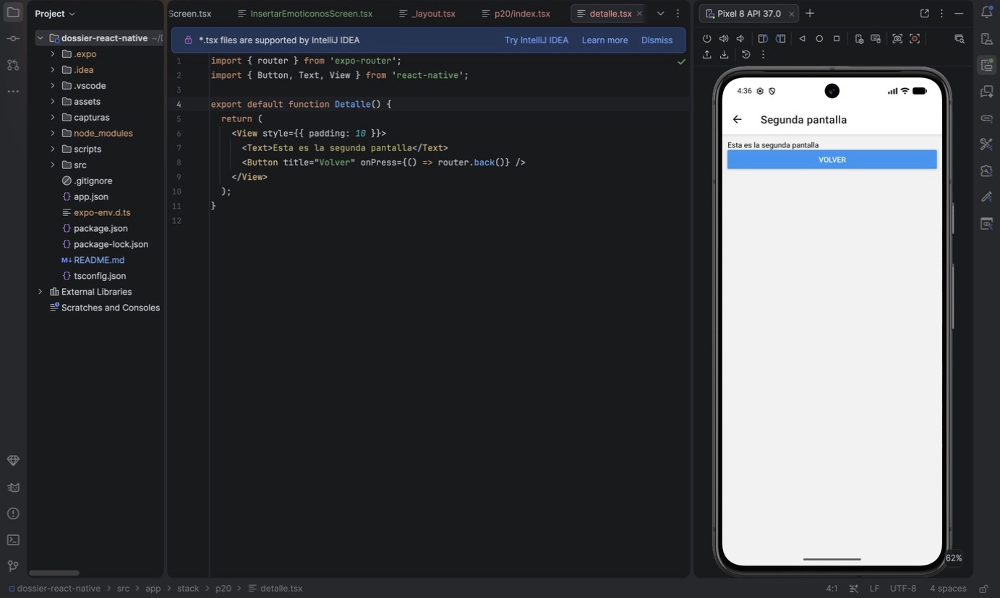

### Problemas que tuve
- Salían dos cabeceras hasta que puse `headerShown: false`.

### Estado
Terminada.

---

## Práctica 21. Stack con tres pantallas

### Qué hay que hacer
Un Stack con tres pantallas. Desde la primera se va a la segunda y a la tercera, y a la tercera se le manda un nombre de usuario que tiene que enseñar.

### Cómo lo he hecho
- Va en `src/app/stack/p21/` con `index.tsx`, `segunda.tsx` y `tercera.tsx`.
- Mando el nombre con `router.push({ pathname: '/stack/p21/tercera', params: { userName } })`.
- En la tercera lo recojo con `useLocalSearchParams`.

### Capturas
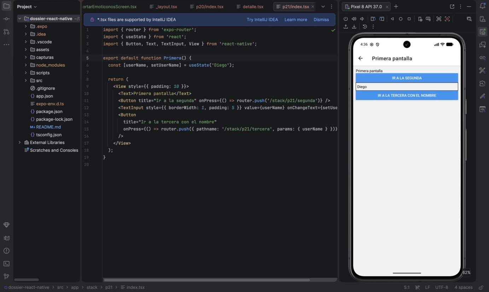

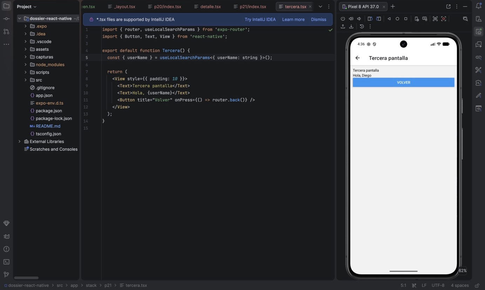

### Problemas que tuve
- Ninguno.

### Estado
Terminada.

---

## Práctica 22. Personalizar la cabecera

### Qué hay que hacer
Un Stack de dos pantallas con la cabecera de otro color, el título en blanco, centrado y con mi nombre, y sin el botón de volver.

### Cómo lo he hecho
- En `screenOptions` del `Stack` puse `title: 'Diego'`, `headerTitleAlign: 'center'`, `headerStyle` con el fondo azul, `headerTintColor: '#fff'` y `headerBackVisible: false`.

### Capturas
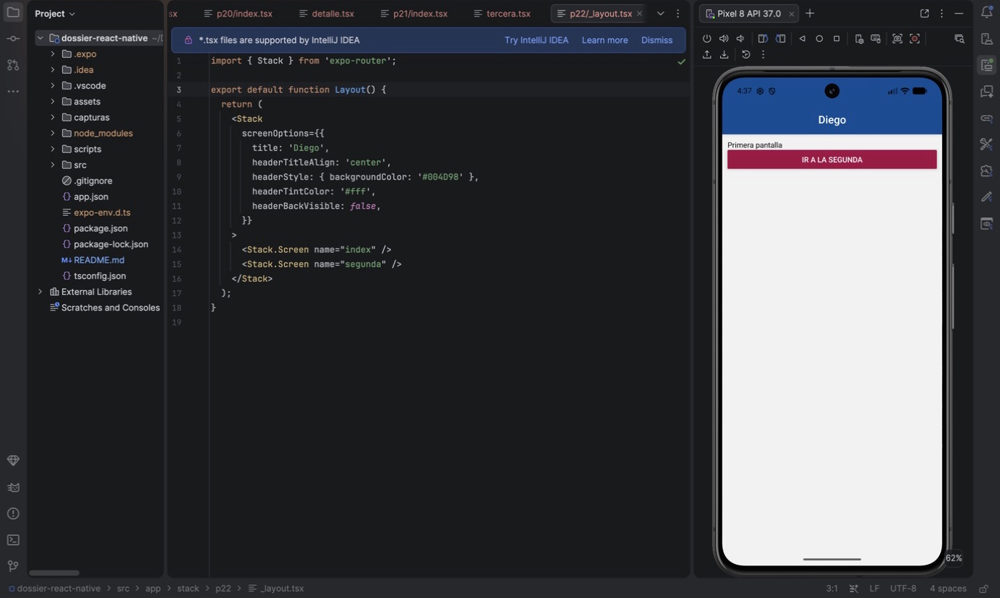

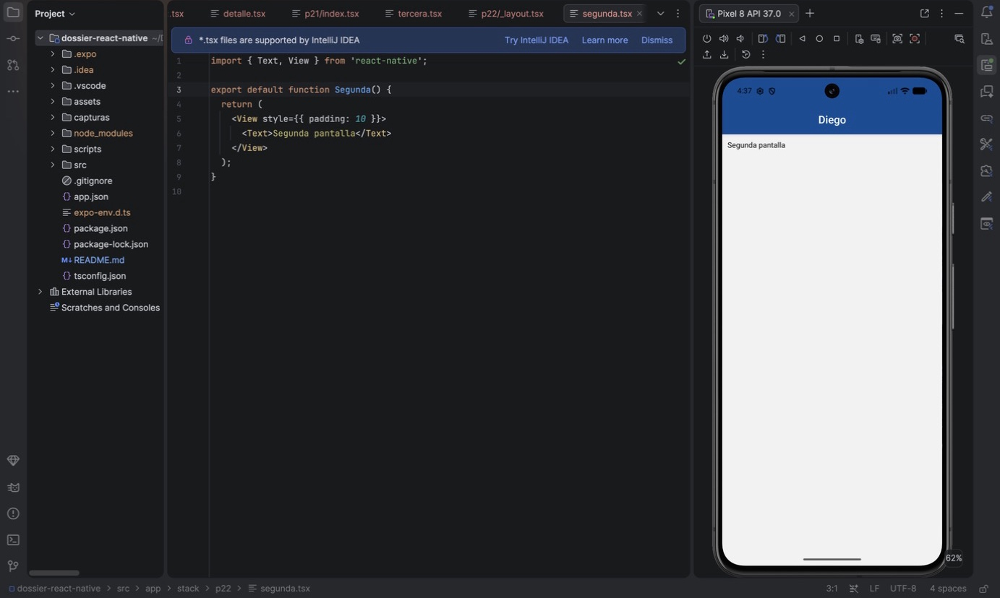

### Problemas que tuve
- Aunque no sale la flecha, con el botón de atrás de Android se sigue pudiendo volver.

### Estado
Terminada.

---

## Práctica 23. Lista de tareas

### Qué hay que hacer
Una lista de tareas con `FlatList` y otra pantalla para crear o editar. Se pueden añadir, marcar como completadas, editar y eliminar, y las completadas salen tachadas y con otro icono. Las tareas se comparten con un Context.

### Cómo lo he hecho
- El contexto está en `src/context/TareasContext.tsx`, como en el ejemplo, y el `TareasProvider` envuelve al `Stack` en el `_layout.tsx`.
- En la lista, cada tarea tiene un icono para marcarla, un lápiz para editar y una papelera para borrar.
- Las completadas llevan `textDecorationLine: 'line-through'`.
- En `editar.tsx`, si la tarea ya existe le cambio el texto, y si no, la añado con `Date.now()` como id.

### Capturas
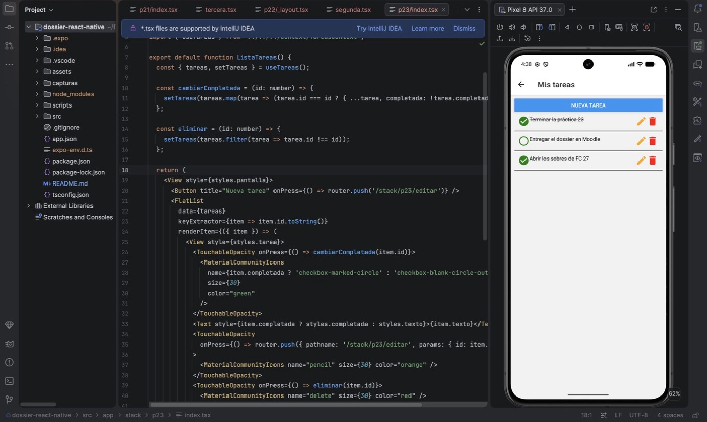

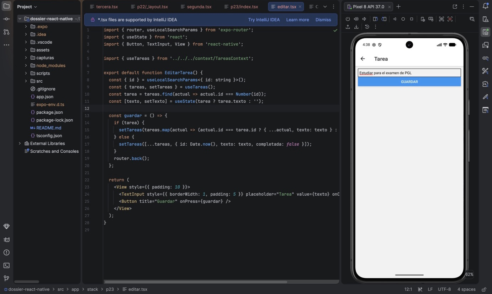

### Problemas que tuve
- TypeScript decía que `/stack/p23/editar` no era una ruta válida hasta que Expo generó los tipos de las rutas nuevas.

### Estado
Terminada.

---

## Práctica 24. Drawer con tareas y About

### Qué hay que hacer
Un Drawer con dos opciones: Tareas, que lleva a un Stack con la lista de tareas y su pantalla de detalle, y About, con mis datos. Se puede aprovechar lo de la práctica 23 sin borrarla.

### Cómo lo he hecho
- En `src/app/drawer/p24/_layout.tsx` pongo el `Drawer` de `expo-router/drawer` dentro de un `GestureHandlerRootView`, y el `TareasProvider` de la práctica 23 alrededor.
- La carpeta `tareas` tiene su propio `_layout.tsx` con un `Stack`. La lista y la pantalla de editar son las de la 23 con las rutas cambiadas.
- `about.tsx` son unos `Text` con mi nombre, el curso y el módulo.

### Capturas
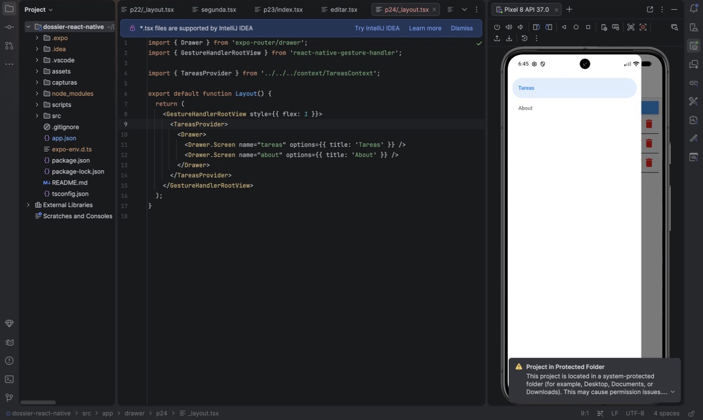

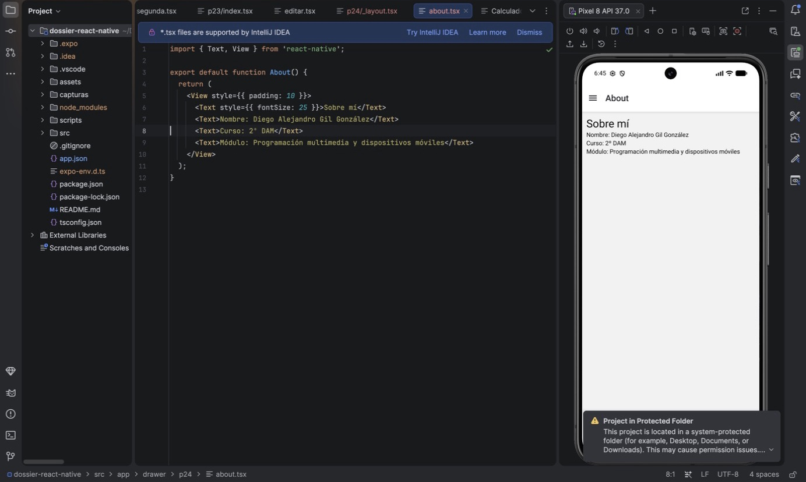

### Problemas que tuve
- En el emulador, al deslizar desde el borde izquierdo Android hacía el gesto de volver atrás en vez de abrir el menú, así que lo abro con el botón de arriba.

### Estado
Terminada.

---

## Práctica 25. Drawer personalizado y girado

### Qué hay que hacer
Repetir el ejemplo de las opciones del Drawer cambiando el color del menú y poniéndole 200 de ancho, probar `drawerContent` con un contenido propio y girar el emulador para ver si el menú sigue saliendo.

### Cómo lo he hecho
- En `src/app/drawer/p25/_layout.tsx` le pongo `drawerStyle: { width: 200, backgroundColor: 'lightyellow' }` y la cabecera en naranja.
- En `drawerContent` pongo un `DrawerContentScrollView` con un `Text` que dice «Menú de Diego» y debajo el `DrawerItemList`.
- Para que la app pueda girar cambié `orientation` de `portrait` a `default` en `app.json`.

Lo que pasa con los enlaces: si pongo `drawerContent` solo con el `Text`, el menú sale pero vacío, sin Inicio ni About, porque mi contenido sustituye al de por defecto. Al añadir `<DrawerItemList {...props} />` vuelven a salir los enlaces y funcionan.

### Capturas


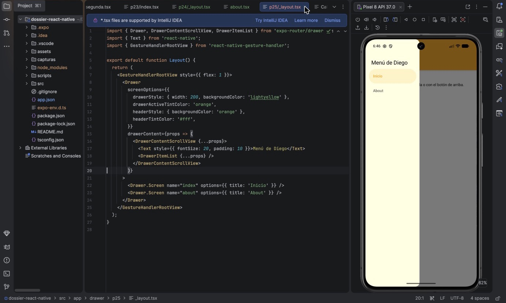

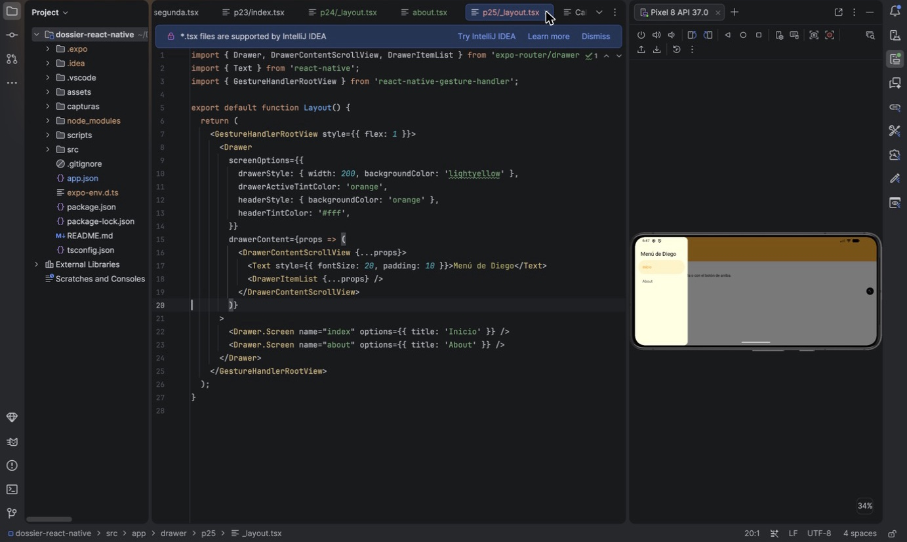

### Problemas que tuve
- Primero importé `DrawerItemList` de `@react-navigation/drawer` y TypeScript daba error con las props. Lo cambié por el de `expo-router/drawer` y se arregló.

### Estado
Terminada.

---

## Práctica 26. Aplicación de mascotas

### Qué hay que hacer
Una app de mascotas con Drawer y una lista. Al pulsar una mascota se abre su ficha, usando el id en la ruta para no hacer un archivo por mascota.

### Cómo lo he hecho
- Las mascotas están en un array en `src/constants/mascotas.ts` con id, nombre, especie, raza y edad.
- En `src/components/` hice `MascotaCard`, que es cada fila de la lista, y `MascotaDetalle`, que es la ficha.
- `src/app/drawer/p26/index.tsx` es la `FlatList`, y al pulsar hago `router.push` a `[id]` pasándole el id.
- En `[id].tsx` cojo el id con `useLocalSearchParams` y busco la mascota con `find`. En el Drawer la oculto con `drawerItemStyle: { display: 'none' }` para que no salga «Ficha» en el menú.

### Capturas
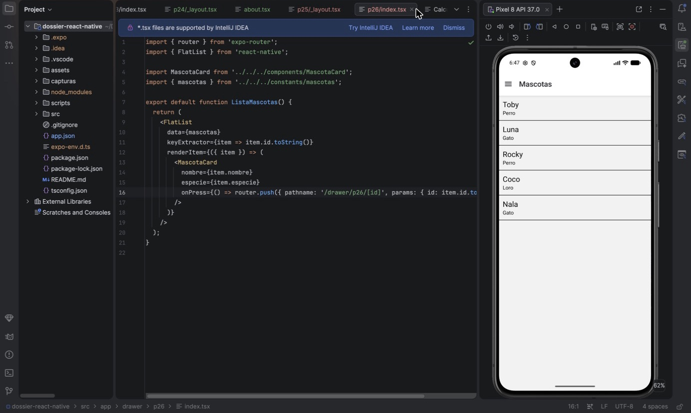

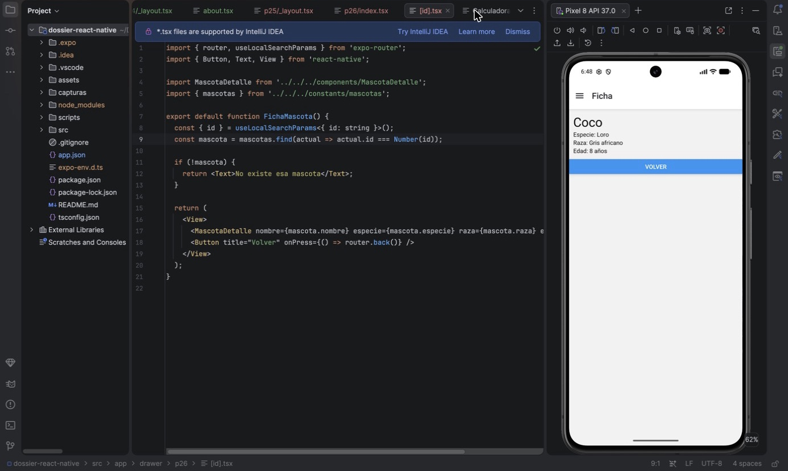

### Estado
Terminada.

---

## Práctica 27. Tabs combinadas con Stack

### Qué hay que hacer
Juntar pestañas con Stack: cada pestaña abre su sección, y desde ella se entra a un detalle y se vuelve sin que cambien las otras pestañas.

### Cómo lo he hecho
- En `src/app/tabs/p27/_layout.tsx` hay un `Tabs` con dos pestañas, Inicio y Perfil, cada una con su icono de `FontAwesome5` en `tabBarIcon`.
- Cada pestaña es una carpeta (`inicio` y `perfil`) con su `_layout.tsx` con un `Stack`, su `index.tsx` y su `detalle.tsx`.
- En el `Tabs` puse `headerShown: false` para que solo salga la cabecera del Stack, que es la que tiene la flecha de volver.
- Si entro al detalle de Inicio, me cambio a Perfil y vuelvo, Inicio sigue en el detalle.

### Capturas
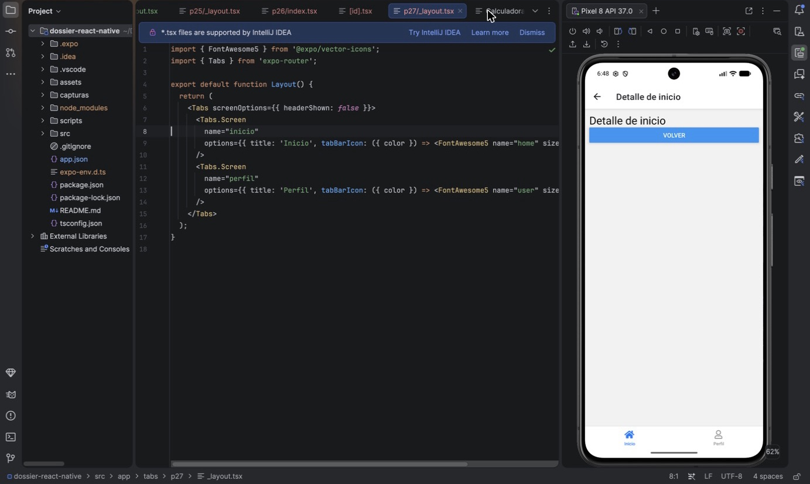

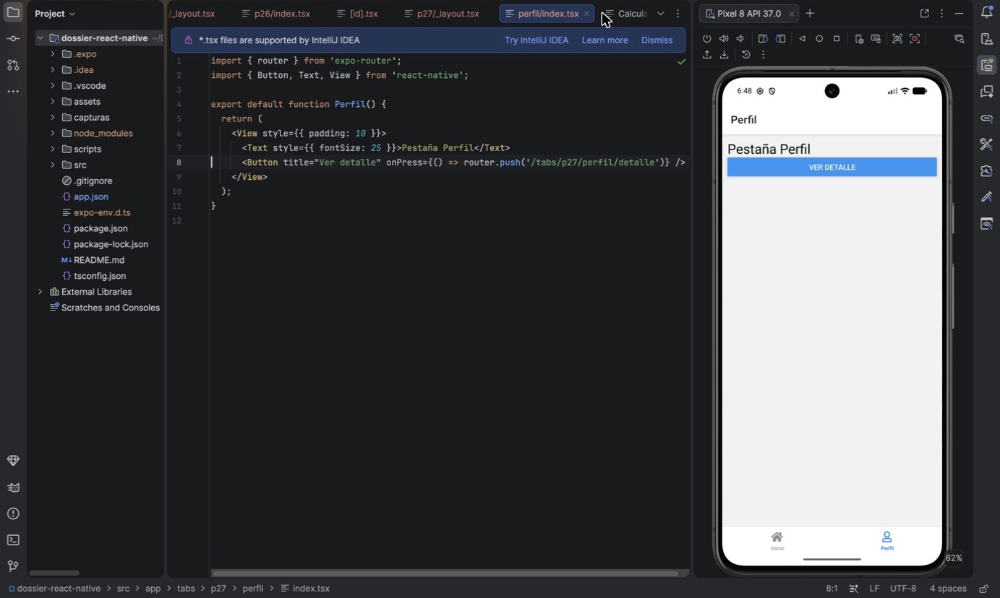

### Estado
Terminada.

---

## Práctica 28. Aplicación Pokémon

### Qué hay que hacer
Una app de Pokémon con la PokeAPI: una lista con el nombre y la imagen, y al pulsar uno, su detalle. Tiene que tener en cuenta cuando está cargando, cuando no hay resultados y cuando hay un error.

### Cómo lo he hecho
- En `src/api/pokemon.ts` hay dos funciones con `fetch`: una para la lista y otra para un Pokémon por su nombre. Si `respuesta.ok` es falso lanzan un error.
- `PokemonCard` en `src/components/` saca la imagen con el número que viene al final de la url de cada Pokémon.
- En la lista uso `useEffect` para cargar, un `ActivityIndicator` mientras carga, un mensaje si hay error y un buscador que dice «No hay resultados» si no encuentra nada.
- El detalle es `[nombre].tsx` y muestra la imagen, el número, la altura, el peso y el tipo.

### Capturas
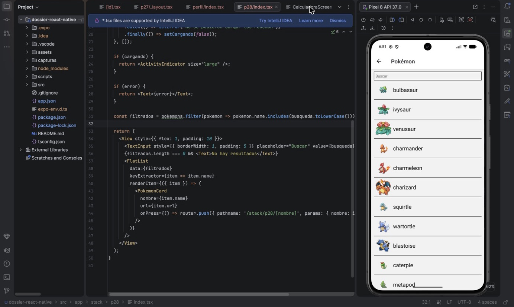

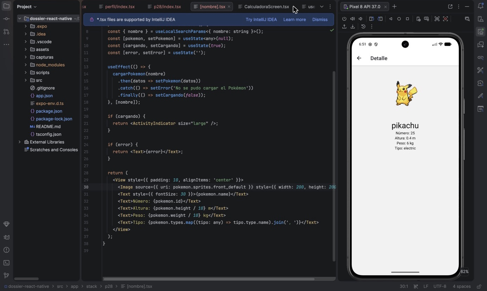

### Estado
Terminada.

---

## Práctica 29. Localización del dispositivo

### Qué hay que hacer
Una pantalla con un botón para pedir el permiso de ubicación y otro para sacar las coordenadas, y enseñar la latitud y la longitud. Si se rechaza el permiso o no se puede sacar la posición, hay que decirlo.

### Cómo lo he hecho
- Instalé `expo-location` con `npx expo install expo-location`.
- «Pedir permiso» llama a `requestForegroundPermissionsAsync` y pone un mensaje si se concede o se rechaza.
- «Obtener ubicación» mira primero el permiso con `getForegroundPermissionsAsync` y luego usa `getCurrentPositionAsync`. Si falla, sale «No se pudo obtener la ubicación».
- Probé a darle a «Don't allow» y salió el mensaje de que había rechazado el permiso.
- Le puse al emulador una ubicación simulada en Las Palmas de Gran Canaria con `adb emu geo fix`.

### Capturas


### Problemas que tuve
- Al darle a «Obtener ubicación», el emulador pedía activar la «Location Accuracy» de Google, y si le decía que no, salía «No se pudo obtener la ubicación». Lo arreglé poniendo `accuracy: Location.Accuracy.High` y `mayShowUserSettingsDialog: false`, y así ya coge la ubicación del GPS del emulador.

### Estado
Terminada.
